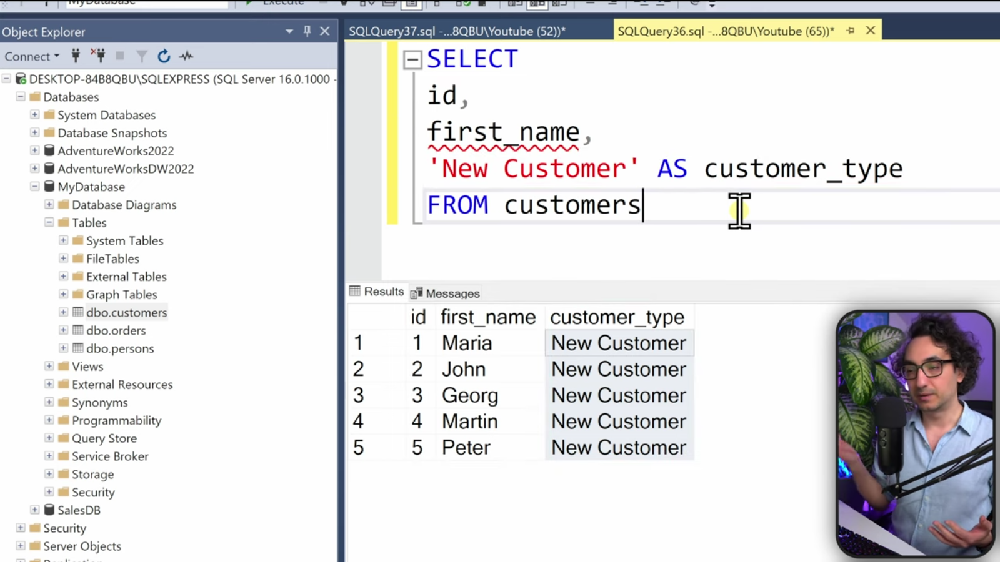

# Clauses

## Common Clauses
- `SELECT`
- `DISTINCT`
- `TOP` (filter based on row number)
- `FROM`
- `WHERE` (filter data before aggregation)
- `GROUP BY`
- `HAVING` (filter data after aggregation)
- `ORDER BY`

## GROUP BY Clause
- Combine rows with the same value.
- Aggregate a column by another column.
- Group by rule: all columns in the SELECT clause must be either aggregated or included in GROUP BY.
- The result of GROUP BY is determined by the unique values of the grouped columns.

## ALIAS
- Shorthand name (label) assigned to a column or table in a query.
- It doesn't exist in the table and only exists inside the query.

## HAVING Clause
- Filters data after aggregation.
- Can be used with GROUP BY.

## DISTINCT
- Removes duplicates (repeated values).
- Each value appears only once.
- Note: Don't use DISTINCT unless it's necessary; it can slow down your query.

## TOP
- Restrict the number of rows returned.

## Execution Order vs Coding Order

### Execution Order

## Static Values
- We can have a mix of values from the database and static values.

