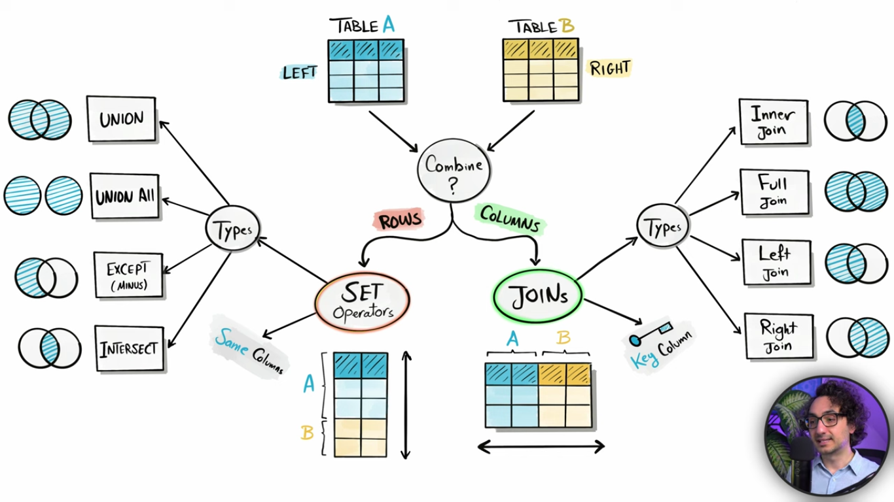

# Combining Data

\- Combining data from multiple table or sources. and for combining data we have set and joins.

we use set when we want to combine rows. in joins we combine table side by side and combine tables using columns.

## Topics
- [Joins](../joins/joins.md) — combine tables side by side using columns.
- [Set Operators](../set-operators/set-operators.md) — combine rows from multiple queries.
