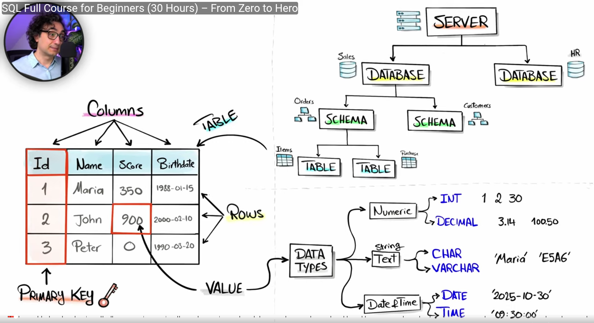

# Databases

## What Is a Database?
A database is like a container — it is a kind of organized collection of data.

**Why database?**
- Organizes data in such a way that it is easier to access, manage, and search. This process is fast and efficient.
- Can handle a large amount of data.
- More secure to store data; controls who can access what.

## Why DBMS?
- Multiple users interact with the database at the same time, so we need some kind of software to manage the requests coming to the database (because the database is just a container that only stores data).
- DBMS handles who can execute a query against the database, which query to run, and how to process the request.
- So, DBMS is the software that manages the database.

## Types of Database
- **Relational Database**
- **Key-Value Pair Database** (Redis, Amazon DB)
- **Column Based Database** — main purpose is to search for data (Apache Cassandra)
- **Graph** (Neo4j)
- **Document** (MongoDB)

## Database Structure
- We have a **server**, and in the server we can have multiple **databases**. Inside a database we have **schemas** (logical containers used to organize the tables in the database), and inside a schema we have multiple **tables** which are made up of rows and columns.

