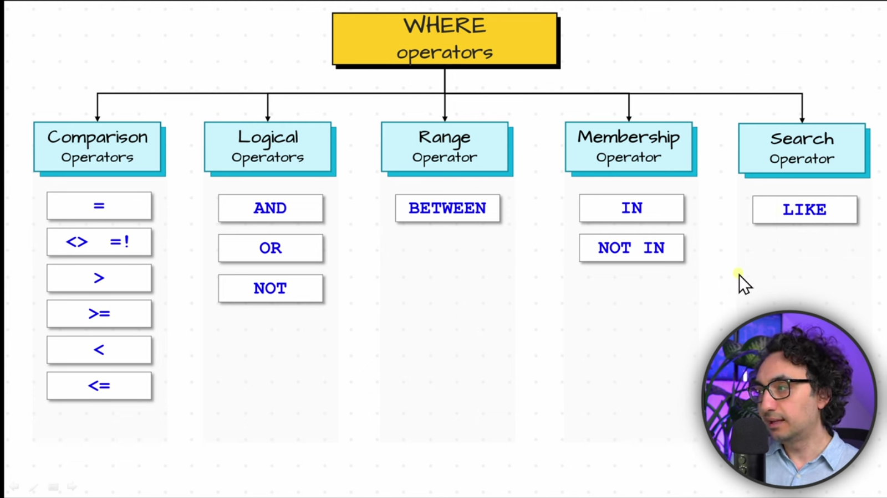
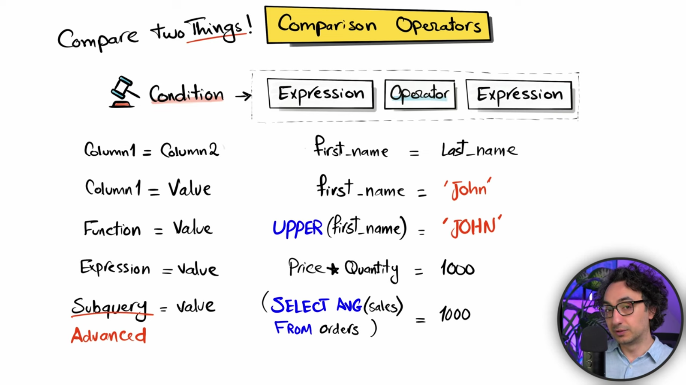
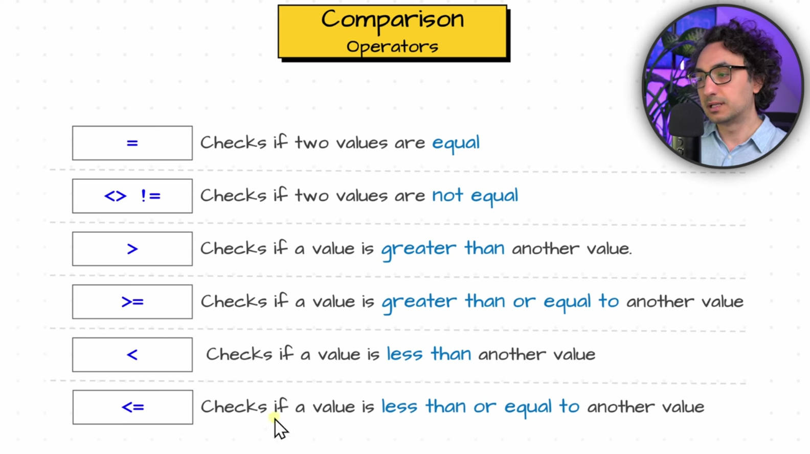
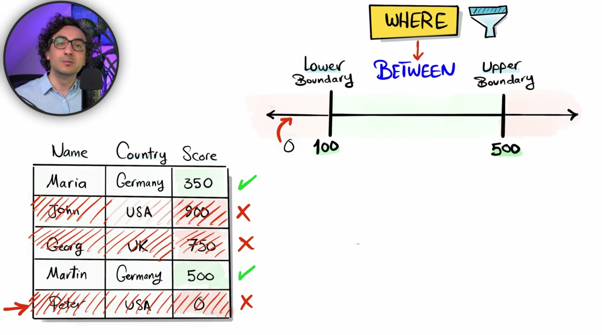
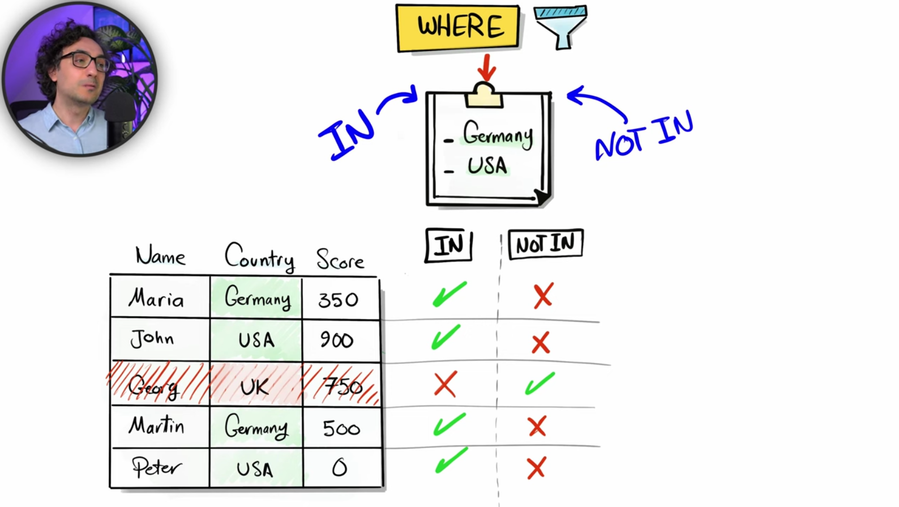
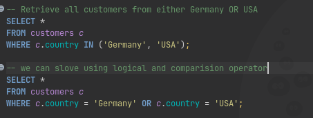
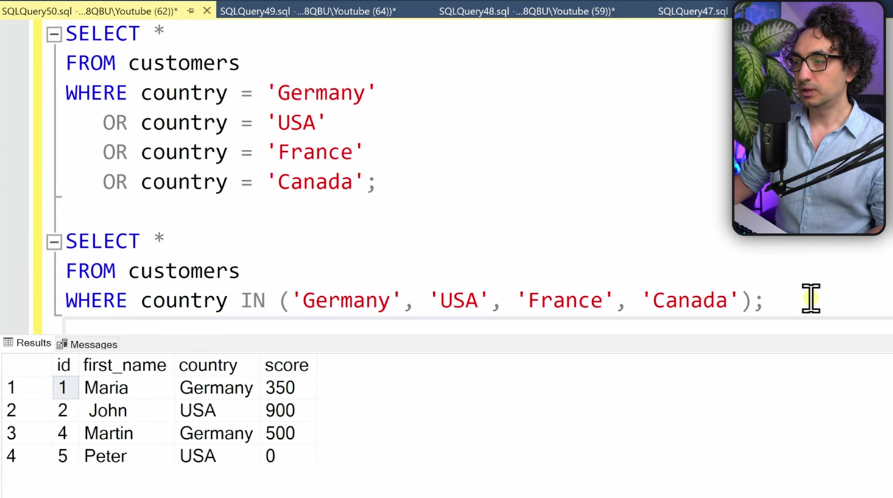
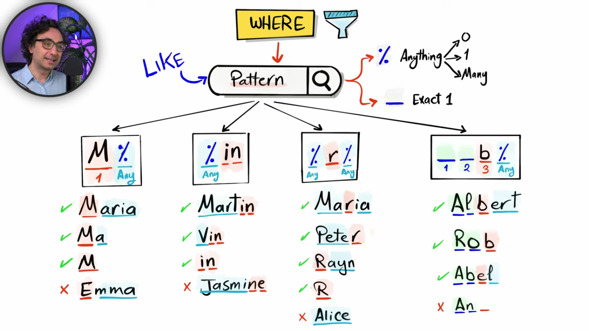
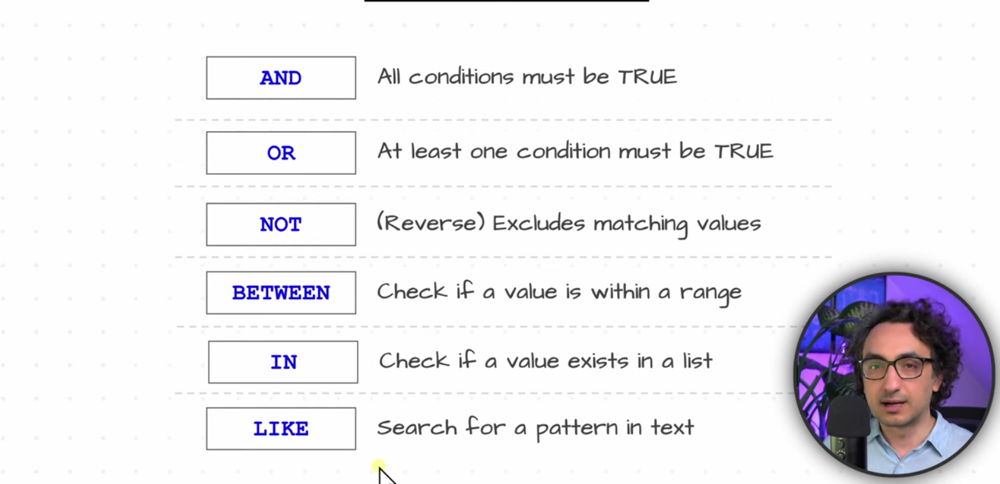

## Filtering Data

← Previous: [Clauses](../clauses/clauses.md) | [Index](../README.md) | Next → [Combining Data](../combining-data/combining-data.md)

### Operators
- An operator is a symbol or keyword that performs an operation on values or expressions.
- Logical operators are a specific category of operators used to combine or reverse conditions.



### Expression
- Definition: An SQL expression is a combination of one or more values, operators, columns, and functions that the database engine evaluates to return a single data value.
- Expressions do not run as standalone commands; instead, they are embedded within SQL statements — such as `SELECT`, `WHERE`, `HAVING`, and `ORDER BY` clauses — to manipulate, filter, or calculate data.

**Definition of an Expression in SQL:**
- An expression is any combination of values (literals), column references, functions, and operators that the database evaluates to produce a single value.
  - Examples of values: `5`, `'hello'`, `CURRENT_DATE`
  - Examples with operators: `2 + 3` (evaluates to 5), `price * 1.1`
  - Examples with functions: `UPPER(name)`, `COUNT(*)`

**Are 2 and 3 > 2 Expressions?**
- `2` is an expression: it is a literal value (specifically a numeric literal) that evaluates to 2.
- `3 > 2` is an expression (specifically a Boolean expression): it combines two values (3 and 2) with a comparison operator (>). It evaluates to a Boolean value: TRUE.

### Condition
- A condition (often called a predicate or Boolean expression) is a specific type of expression that evaluates to a Boolean value (`TRUE`, `FALSE`, or `UNKNOWN`).
- It is used to filter or control logic, typically inside `WHERE`, `HAVING`, or `ON` clauses.


**Is a Comparison Condition Called a "Condition" or an "Expression"?**
- It is both. In SQL terminology, a condition is just a specialized type of expression that evaluates to a Boolean value (`TRUE`, `FALSE`, or `UNKNOWN`).
  - **Expression perspective:** Anything that returns a value is an expression. Because a comparison like `3 > 2` returns TRUE or FALSE, it fits the formal definition of an expression.
  - **Condition perspective:** When you place that same logic inside a filtering clause (like `WHERE` or `HAVING`) to decide which rows to keep or discard, it functions as a condition.
- In short: All conditions in SQL are expressions (specifically, ones that yield a true/false result), though not all expressions are used as conditions (e.g., an arithmetic expression like `2 + 3` yields a number, not a truth value).

### Comparison Operators
\- These compare two values and produce a comparison result.


```sql
	SELECT * 
	FROM users
	WHERE age >= 18;
```

The >= operator compares each user's age with 18. The WHERE clause uses the comparison result to determine which rows qualify.



### Logical Operators
\- Logical operators combine conditions or reverse a condition to form more complex logical tests.
  The three main logical operators are AND, OR, and NOT.

### Range Operator
\- Boundary are inclusive, if we have score value exactly 100 or 500 it will be included on results.



### Membership Operator
\- How IN and NOT IN  filter the row. If the column value is in the list we provided then it will include that row in the results

 
>Note: Use IN operator instead of OR for multiple values in the same columnt to simplify SQL.

**Example 1**


**Example 2** 


### Search Operators



### Summary of Operators


