## SQL Functions

← Previous: [Set Operators](../set-operators/set-operators.md) | [Index](../README.md) | Next → [Practice (sql/)](../sql)

We have data inside table and we can perform different operation on data like we can change the value of the data like doing data manipulation, data analysis to generate report or find insights, data cleaning or data transformation in order to solve some sql task. and in sql to solve this task we have functions.

**What is functions?**

\- A Built in SQL code:
- accept an input value
- process it
- returns an output value

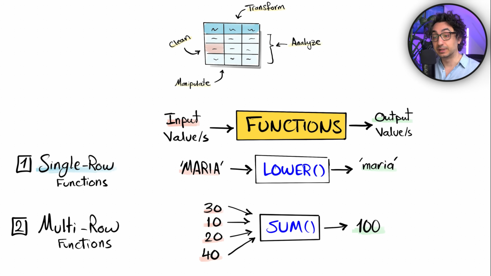

**Nested Functions**

\- Function use inside another function.

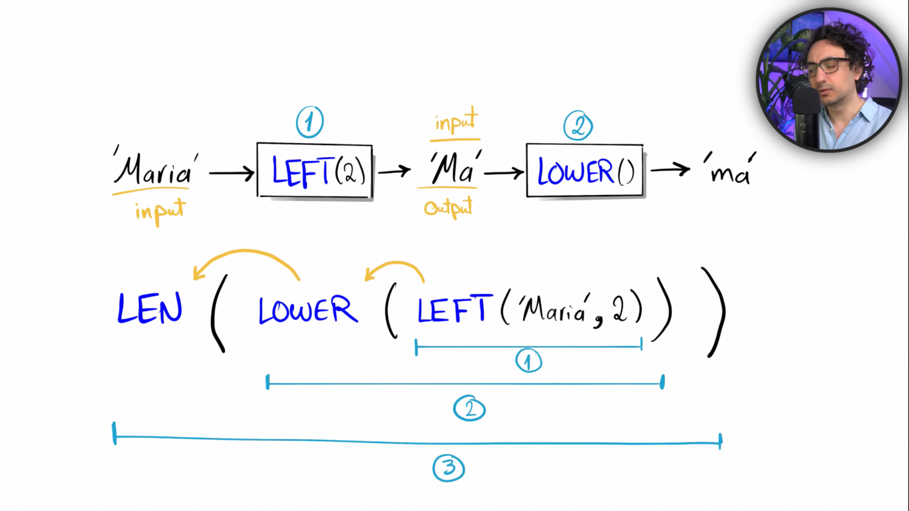

### Types of SQL Functions

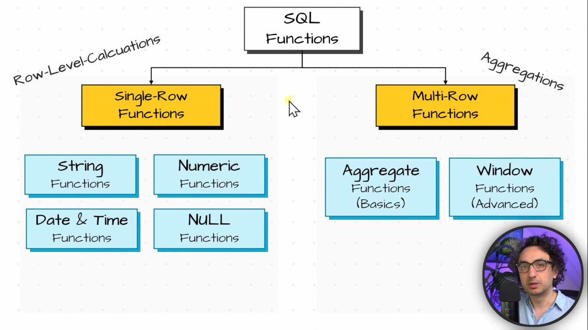

SQL functions are grouped into single-row functions and aggregate functions.

### Topics

- [Single-Row Functions](#single-row-functions-row-level-calculation) — run on each row and return one value per row.
- Aggregate Functions — summarize many rows into a single value.

### Single-Row Functions (Row-Level Calculation)

Single-row functions work on one row at a time.

#### Topics

- [String Functions](#string-functions)
- [Number Functions](#number-functions)
- [Date & Time Functions](#date--time-functions)
- [Null Functions](#null-functions)

#### String Functions

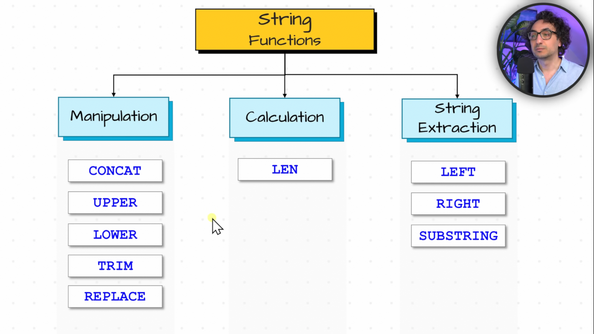

##### Manipulation

###### **CONCAT**

\- Combine multiple string into one.

**Example**

```sql
-- Concatenate first name and country into one column
SELECT
    c.first_name,
    c.country,
    CONCAT(c.first_name , '-' ,c.country ) AS name_country
FROM customers c;
```

###### **LOWER & UPPER**

**Example**

```sql
-- convert the customer first name to lowercase
SELECT
    c.first_name,
    LOWER(c.first_name) AS low_name
FROM customers c ;

-- conver the customer first name to uppercase
SELECT
    c.first_name,
    UPPER(c.first_name )
FROM customers c ;
```

###### **TRIM**

\- Remove Leading and Trailing spaces.

**Example**

```sql
-- find customers whose first name contains leading or trailing spaces
SELECT
    c.first_name,
    LEN(c.first_name) AS len_name,
    LEN(TRIM(c.first_name)) AS len_trim_name,
    LEN(c.first_name) - LEN(TRIM(c.first_name )) AS flag
FROM customers c
--WHERE LEN(c.first_name) <> LEN(TRIM(c.first_name ))
WHERE c.first_name <> TRIM(c.first_name);
```

###### **REPLACE**

\- Replace specific character with a new character
\- It not only replace but can be used to remove the value.

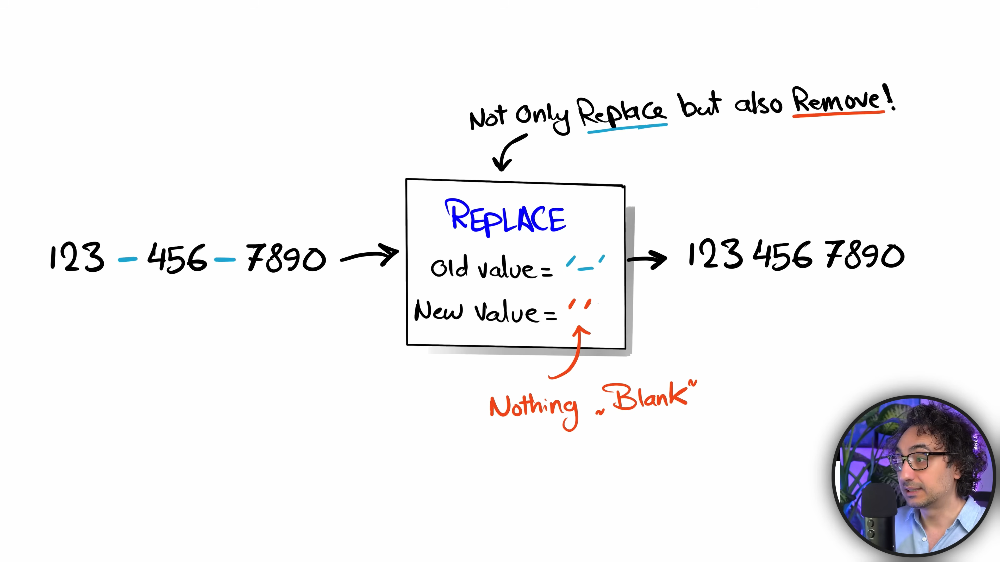

**Example**

```sql
-- Remove dashes (-) from a phone number
SELECT
    '123-246-464' AS phone_number,
    REPLACE('123-246-464', '-', '/') AS clean_phone

-- Replace File Extension from txt to csv
SELECT
    'reports.txt' AS old_filename,
    REPLACE('reports.txt', '.txt', '.csv')
```

##### Calculation

###### **LEN**

\- Count how many characters
\- Can be used with number, character and date

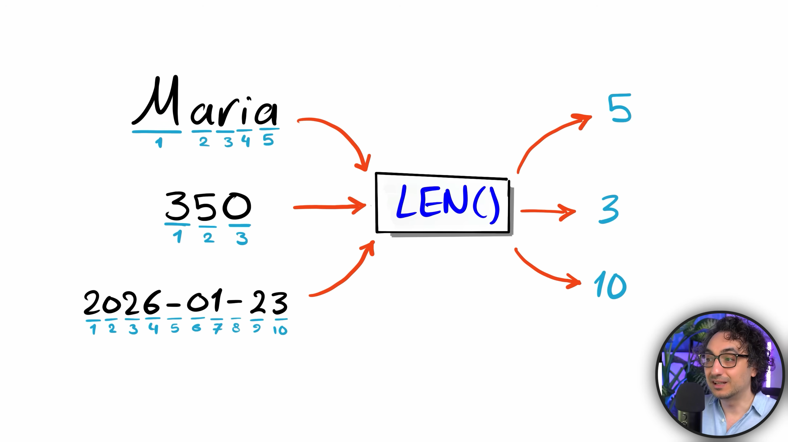

**Example**

```sql
-- Calcualte the length of each customers first name
SELECT
    c.first_name,
    LEN(c.first_name) AS len_name
FROM customers c
```

##### String Extraction

###### **LEFT**

\- Extract specific number of characters from the start
\- Syntax: LEFT(value,  length)

###### **RIGHT**

\- Extract specific number of characters from the end
\- Syntax: RIGHT(value,  length)

**Example**

```sql
-- Retrieve the first two characters of each first name
SELECT
    c.first_name,
    LEFT(TRIM(c.first_name), 2) AS first_two_char
FROM customers c

-- Retrieve the last two characters of each first name
SELECT
    c.first_name,
    RIGHT(c.first_name , 2) AS last_two_char
FROM customers c
```

###### **SUBSTRING**

\- Extract a part of a string at a specified position
\- Syntax: SUBSTRING(value, start, length)

**Example**

```sql
-- Retrieve a list of customer's first name removing the first character
SELECT
    c.first_name,
    SUBSTRING(TRIM(c.first_name), 2, LEN(c.first_name)) AS sub_name
FROM customers c
```

#### Number Functions

###### **ROUND**

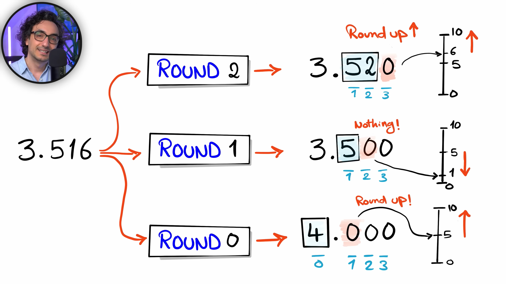

**Example**

```sql
SELECT
    3.516,
    ROUND(3.516, 2) AS round_2,
    ROUND(3.516, 1) AS round_1,
    ROUND(3.516, 0) AS round_0
```

###### **ABS**

\- Convert negative number to positive

**Example**

```sql
SELECT
    -10,
    ABS(-10),
    ABS(10)
```

#### Date & Time Functions

**Manipulation Date**

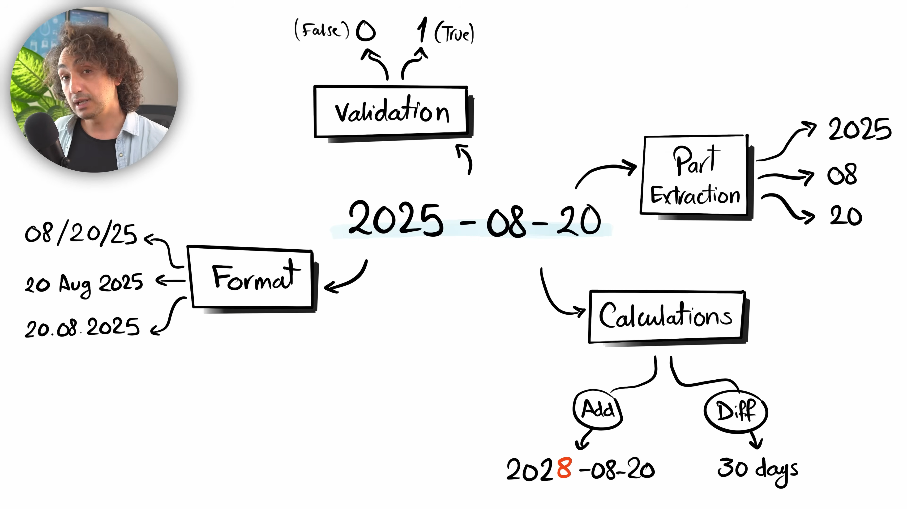

We can use different operation to manipulate date. we can manipulate the date value by extracting some part of date, or change the format of the date, or we can use to calculate the difference between two date and lastly we can validate the given date which result in 0 (false) if date is invalid and 1 if the date is in valid format.

**Different Date and Time Functions**

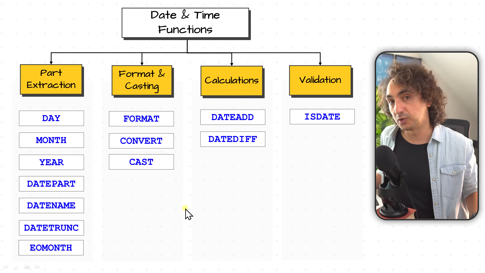

###### **GETDATE**

\- We can use GETDATE function to get date value. it is one of 3 ways to get date value in sql. first way is to get from column value with date type, second is static value and last way is to use GETDATE function.
\- return the current date and time at the moment when the query is executed.

##### Part Extraction

###### **DAY**

\- Return the day from Date
\- Syntax: DAY(date)

###### **MONTH**

\- Return the month from Date
\- Syntax: MONTH(date)

###### **YEAR**

\- Return the year from Date
\- Syntax: YEAR(date)

```sql
-- YEAR, MONTH, DAY
SELECT
    o.OrderID ,
    o.CreationTime,
    YEAR(o.CreationTime ) as Year,
    MONTH(o.CreationTime ) as Month,
    DAY(o.CreationTime ) as Day
FROM Sales.Orders o
```

###### **DATEPART**

\- Return specific part of a date as a number like week, or quater.
\- Syntax: DATEPART(part, date)
\- Example for month: DATEPART(month, OrderDate)
\- we can also use abbreviation of part like mm. DATEPART(mm, '2026-09-20')
\- the return value of this function is always of int type

```sql
-- DATEPART
SELECT
    o.OrderID ,
    o.CreationTime,
    DATEPART(year, o.CreationTime ) as Year_dp,
    DATEPART(month, o.CreationTime ) as Month_dp,
    DATEPART(day, o.CreationTime ) as Day_dp,
    DATEPART(hour, o.CreationTime ) as Hour,
    DATEPART(quarter, o.CreationTime ) as Quater_dp,
    DATEPART(week, o.CreationTime ) as Week_dp
FROM Sales.Orders o
```

| OrderID | CreationTime            | Year_dp | Month_dp | Day_dp | Hour | Quater_dp | Week_dp |
| ------- | ----------------------- | ------- | -------- | ------ | ---- | --------- | ------- |
| 1       | 2025-01-01 12:34:56.000 | 2025    | 1        | 1      | 12   | 1         | 1       |
| 2       | 2025-01-05 23:22:04.000 | 2025    | 1        | 5      | 23   | 1         | 2       |
| 3       | 2025-01-10 18:24:08.000 | 2025    | 1        | 10     | 18   | 1         | 2       |
| 4       | 2025-01-20 05:50:33.000 | 2025    | 1        | 20     | 5    | 1         | 4       |
| 5       | 2025-02-01 14:02:41.000 | 2025    | 2        | 1      | 14   | 1         | 5       |
| 6       | 2025-02-06 15:34:57.000 | 2025    | 2        | 6      | 15   | 1         | 6       |
| 7       | 2025-02-16 06:22:01.000 | 2025    | 2        | 16     | 6    | 1         | 8       |
| 8       | 2025-02-18 10:45:22.000 | 2025    | 2        | 18     | 10   | 1         | 8       |
| 9       | 2025-03-10 12:59:04.000 | 2025    | 3        | 10     | 12   | 1         | 11      |
| 10      | 2025-03-16 23:25:15.000 | 2025    | 3        | 16     | 23   | 1         | 12      |

###### **DATENAME**

\- Returns the name of a specific part of a date
\- The return value of this function is string.
\- Syntax: DATENAME(part, date) -> return string

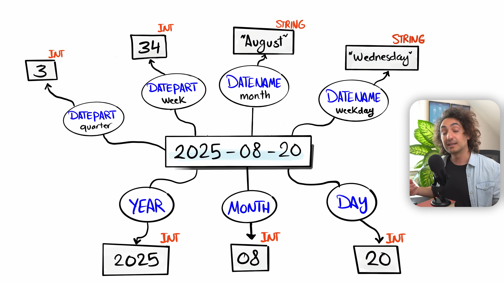

**Example**

```sql
-- DATENAME
SELECT
    o.OrderID,
    o.CreationTime,
    DATENAME(month, o.CreationTime) AS mon_day,
    DATENAME(weekday, o.CreationTime) AS week_day,
    DATENAME(day, o.CreationTime) AS day_name,
    DATENAME(year, o.CreationTime) AS year_dn,
    DATEPART(month, o.CreationTime) AS mon_dp,
    DATEPART(week, o.CreationTime) AS week_dp
FROM Sales.Orders o
```

| OrderID | CreationTime            | mon_day  | week_day  | day_name | year_dn | mon_dp | week_dp |
| ------- | ----------------------- | -------- | --------- | -------- | ------- | ------ | ------- |
| 1       | 2025-01-01 12:34:56.000 | January  | Wednesday | 1        | 2025    | 1      | 1       |
| 2       | 2025-01-05 23:22:04.000 | January  | Sunday    | 5        | 2025    | 1      | 2       |
| 3       | 2025-01-10 18:24:08.000 | January  | Friday    | 10       | 2025    | 1      | 2       |
| 4       | 2025-01-20 05:50:33.000 | January  | Monday    | 20       | 2025    | 1      | 4       |
| 5       | 2025-02-01 14:02:41.000 | February | Saturday  | 1        | 2025    | 2      | 5       |
| 6       | 2025-02-06 15:34:57.000 | February | Thursday  | 6        | 2025    | 2      | 6       |
| 7       | 2025-02-16 06:22:01.000 | February | Sunday    | 16       | 2025    | 2      | 8       |
| 8       | 2025-02-18 10:45:22.000 | February | Tuesday   | 18       | 2025    | 2      | 8       |
| 9       | 2025-03-10 12:59:04.000 | March    | Monday    | 10       | 2025    | 3      | 11      |
| 10      | 2025-03-16 23:25:15.000 | March    | Sunday    | 16       | 2025    | 3      | 12      |

Here DATENAME(day, date) and DATENAME(year, date) return number of string type which is different from DATEPART() function which return number of int type.
So, most important part of DATENAME() function is to provide more human readable information to users.

###### **DATETRUNC**

\- Truncates the date to the specific part
\- Syntax: DATETRUNC(part, date) -> return date or datetime
\- It is not extracting the part but reseting the part

**Concept — it resets the parts instead of extracting them**

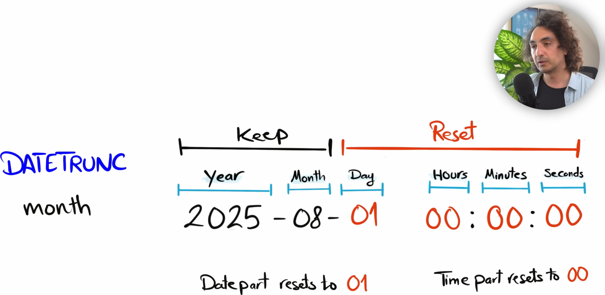

**Examples**

| `DATETRUNC(minute, date)`                        | `DATETRUNC(hour, date)`                      |
| ------------------------------------------------ | -------------------------------------------- |
| 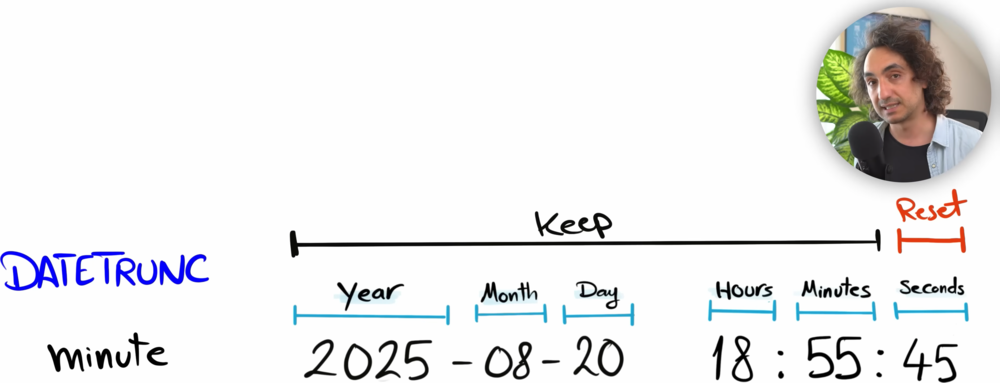 | 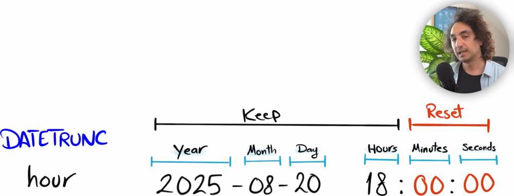 |

**Result**

```sql
-- DATETRUNC
SELECT
    o.OrderID,
    o.CreationTime,
    DATETRUNC(minute, o.CreationTime) AS minute_dt,
    DATETRUNC(day, o.CreationTime) AS day_dt,
    DATETRUNC(year, o.CreationTime) AS year_dt
FROM Sales.Orders o
```

| OrderID | CreationTime            | minute_dt               | day_dt                  | year_dt                 |
| ------- | ----------------------- | ----------------------- | ----------------------- | ----------------------- |
| 1       | 2025-01-01 12:34:56.000 | 2025-01-01 12:34:00.000 | 2025-01-01 00:00:00.000 | 2025-01-01 00:00:00.000 |
| 2       | 2025-01-05 23:22:04.000 | 2025-01-05 23:22:00.000 | 2025-01-05 00:00:00.000 | 2025-01-01 00:00:00.000 |
| 3       | 2025-01-10 18:24:08.000 | 2025-01-10 18:24:00.000 | 2025-01-10 00:00:00.000 | 2025-01-01 00:00:00.000 |
| 4       | 2025-01-20 05:50:33.000 | 2025-01-20 05:50:00.000 | 2025-01-20 00:00:00.000 | 2025-01-01 00:00:00.000 |
| 5       | 2025-02-01 14:02:41.000 | 2025-02-01 14:02:00.000 | 2025-02-01 00:00:00.000 | 2025-01-01 00:00:00.000 |
| 6       | 2025-02-06 15:34:57.000 | 2025-02-06 15:34:00.000 | 2025-02-06 00:00:00.000 | 2025-01-01 00:00:00.000 |
| 7       | 2025-02-16 06:22:01.000 | 2025-02-16 06:22:00.000 | 2025-02-16 00:00:00.000 | 2025-01-01 00:00:00.000 |
| 8       | 2025-02-18 10:45:22.000 | 2025-02-18 10:45:00.000 | 2025-02-18 00:00:00.000 | 2025-01-01 00:00:00.000 |
| 9       | 2025-03-10 12:59:04.000 | 2025-03-10 12:59:00.000 | 2025-03-10 00:00:00.000 | 2025-01-01 00:00:00.000 |
| 10      | 2025-03-16 23:25:15.000 | 2025-03-16 23:25:00.000 | 2025-03-16 00:00:00.000 | 2025-01-01 00:00:00.000 |

**Use Case of DATETRUNC**

```sql
-- USE CASE
SELECT
    DATETRUNC(month, o.CreationTime) AS month_dt,
    COUNT(*) AS total_order
FROM Sales.Orders o
GROUP BY DATETRUNC(month, o.CreationTime)
```

| month_dt                | total_order |
| ----------------------- | ----------- |
| 2025-01-01 00:00:00.000 | 4           |
| 2025-02-01 00:00:00.000 | 4           |
| 2025-03-01 00:00:00.000 | 2           |

###### **EOMONTH**

\- Returns last day of a month
\- Syntax: EOMONTH(date)

```sql
-- EOMONTH
SELECT
    o.OrderID ,
    o.CreationTime,
    EOMONTH(o.CreationTime ) as end_of_month,
    CAST(DATETRUNC(month, o.CreationTime ) as DATE )as start_of_month ROM Sales.Orders o

```

| OrderID | CreationTime            | end_of_month | start_of_month |
| ------- | ----------------------- | ------------ | -------------- |
| 1       | 2025-01-01 12:34:56.000 | 2025-01-31   | 2025-01-01     |
| 2       | 2025-01-05 23:22:04.000 | 2025-01-31   | 2025-01-01     |
| 3       | 2025-01-10 18:24:08.000 | 2025-01-31   | 2025-01-01     |
| 4       | 2025-01-20 05:50:33.000 | 2025-01-31   | 2025-01-01     |
| 5       | 2025-02-01 14:02:41.000 | 2025-02-28   | 2025-02-01     |
| 6       | 2025-02-06 15:34:57.000 | 2025-02-28   | 2025-02-01     |
| 7       | 2025-02-16 06:22:01.000 | 2025-02-28   | 2025-02-01     |
| 8       | 2025-02-18 10:45:22.000 | 2025-02-28   | 2025-02-01     |
| 9       | 2025-03-10 12:59:04.000 | 2025-03-31   | 2025-03-01     |
| 10      | 2025-03-16 23:25:15.000 | 2025-03-31   | 2025-03-01     |

> we use CAST function to change the data type to date. datetrunc return datetime type

###### Part Extraction Use Case

\- **Data Aggregation and Reporting**

```sql
-- How many orders were placed each year?
SELECT
    YEAR(o.OrderDate) as order_date,
    COUNT(*) as no_of_order
FROM Sales.Orders o
GROUP BY YEAR(o.OrderDate );
```

```sql
-- How many orders were placed each month?
SELECT
    DATENAME(month, o.OrderDate) as order_date,
    COUNT(*) as no_of_orders
FROM Sales.Orders o
GROUP BY DATENAME(month, o.OrderDate )
```

| order_date | no_of_orders |
| ---------- | ------------ |
| February   | 4            |
| January    | 4            |
| March      | 2            |

\- **Data Filtering**

```sql
-- Show all order that were placed during the month of february
SELECT
    *
FROM Sales.Orders o
WHERE MONTH(o.OrderDate ) = 2
```

| OrderID | ProductID | CustomerID | SalesPersonID | OrderDate  | ShipDate   | OrderStatus | ShipAddress      | BillAddress  | Quantity | Sales | CreationTime            |
| ------- | --------- | ---------- | ------------- | ---------- | ---------- | ----------- | ---------------- | ------------ | -------- | ----- | ----------------------- |
| 5       | 104       | 2          | 5             | 2025-02-01 | 2025-02-05 | Delivered   |                  |              | 1        | 25    | 2025-02-01 14:02:41.000 |
| 6       | 104       | 3          | 5             | 2025-02-05 | 2025-02-10 | Delivered   | 1792 Belmont Rd. |              | 2        | 50    | 2025-02-06 15:34:57.000 |
| 7       | 102       | 1          | 1             | 2025-02-15 | 2025-02-27 | Delivered   | 136 Balboa Court |              | 2        | 30    | 2025-02-16 06:22:01.000 |
| 8       | 101       | 4          | 3             | 2025-02-18 | 2025-02-27 | Shipped     | 2947 Vine Lane   | 4311 Clay Rd | 3        | 90    | 2025-02-18 10:45:22.000 |

 > Best Practice: Filtering Data using an Integer is faster than using a String. Avoid using DATENAME for filtering data, instead used DATEPART

###### **Function Comparision**

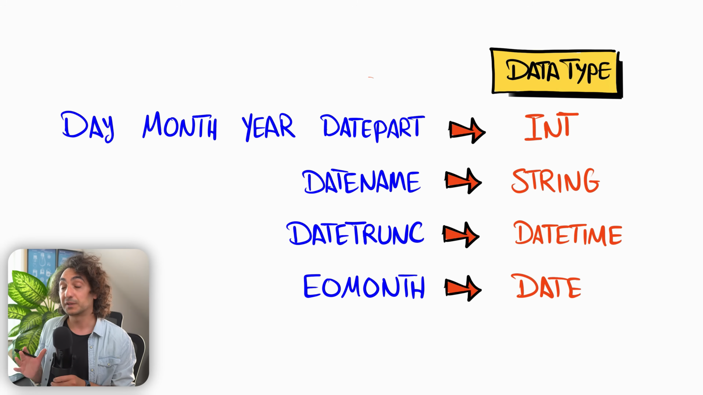

**How to choose which function to use?**

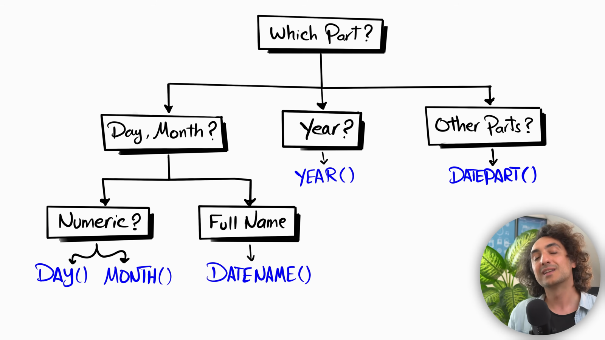

###### All Parts

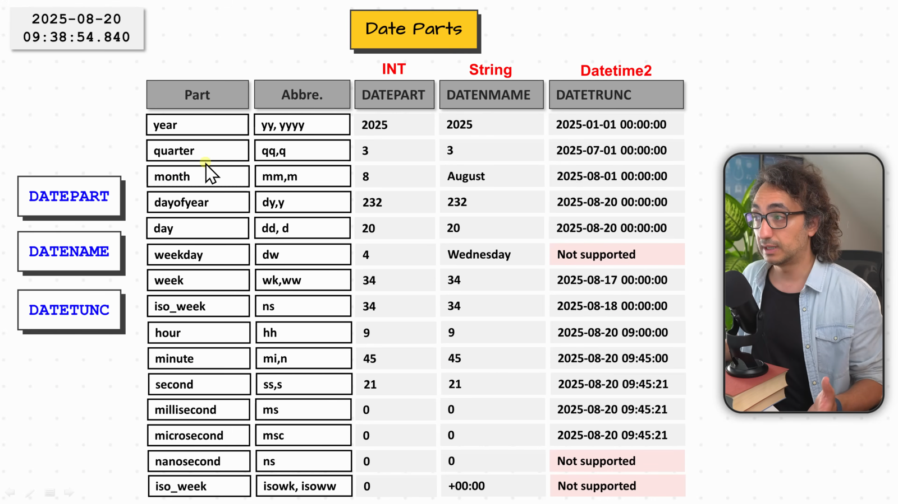

##### Format & Casting

###### What is Date Format?

\- format specifier (how date is stored)

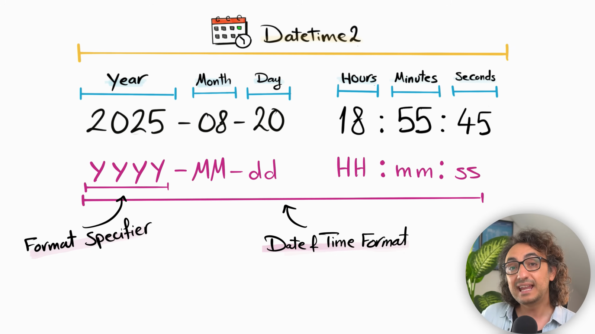

This whole is data format representation of this value. In world, there are different ways to represent a date.

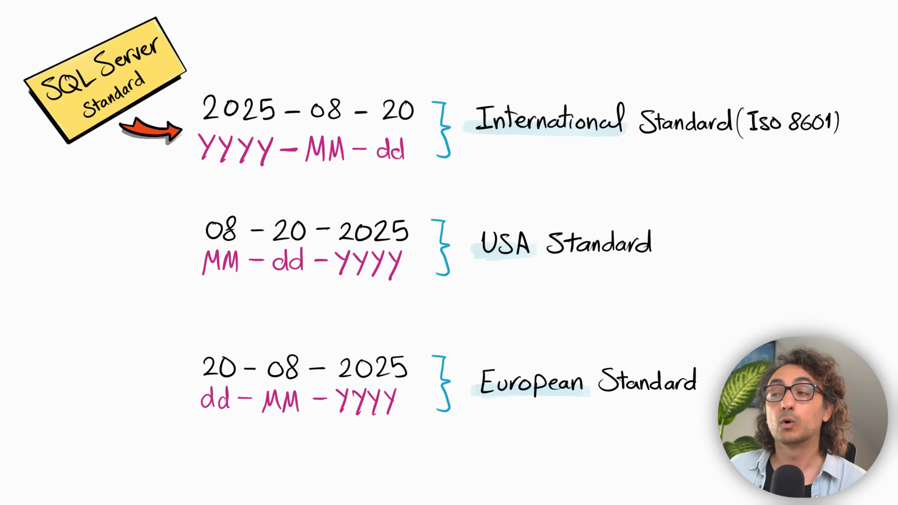

###### **Formatting**

Changing the format of a value from one to another. We are just changing how the value looks like.

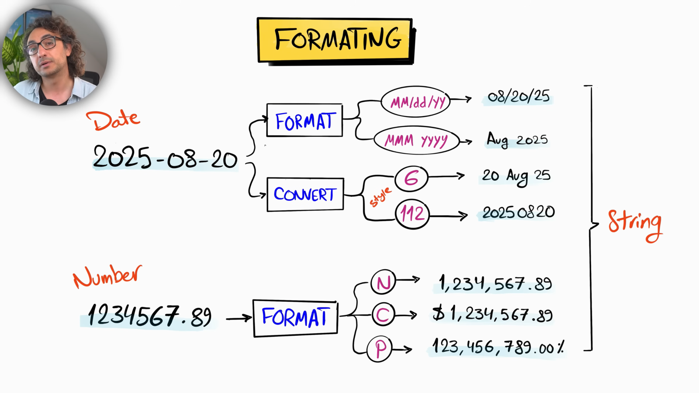

###### **FORMAT**

\- Format a date or time value
\- Format(value, format [, culture]), culture is optional
\- culture means format representation based on specific country or region

```sql
SELECT
    o.OrderID,
    o.CreationTime ,
    FORMAT(o.creationTime, 'MM-dd-yyyy') as usa_format,
    FORMAT(o.creationTime, 'dd-MM-yyyy') as euro_format,
    FORMAT(o.CreationTime , 'MMMM') as MMMM,
    FORMAT(o.CreationTime , 'MMM') as MMM,
    FORMAT(o.CreationTime , 'MM') as MM,
    FORMAT(o.CreationTime , 'dddd') as ddd,
    FORMAT(o.CreationTime , 'ddd') as ddd,
    FORMAT(o.CreationTime , 'dd') as dd
FROM Sales.Orders o
```

| OrderID | CreationTime            | usa_format | euro_format | MMMM     | MMM | MM  | ddd       | ddd | dd  |
| ------- | ----------------------- | ---------- | ----------- | -------- | --- | --- | --------- | --- | --- |
| 1       | 2025-01-01 12:34:56.000 | 01-01-2025 | 01-01-2025  | January  | Jan | 01  | Wednesday | Wed | 01  |
| 2       | 2025-01-05 23:22:04.000 | 01-05-2025 | 05-01-2025  | January  | Jan | 01  | Sunday    | Sun | 05  |
| 3       | 2025-01-10 18:24:08.000 | 01-10-2025 | 10-01-2025  | January  | Jan | 01  | Friday    | Fri | 10  |
| 4       | 2025-01-20 05:50:33.000 | 01-20-2025 | 20-01-2025  | January  | Jan | 01  | Monday    | Mon | 20  |
| 5       | 2025-02-01 14:02:41.000 | 02-01-2025 | 01-02-2025  | February | Feb | 02  | Saturday  | Sat | 01  |
| 6       | 2025-02-06 15:34:57.000 | 02-06-2025 | 06-02-2025  | February | Feb | 02  | Thursday  | Thu | 06  |
| 7       | 2025-02-16 06:22:01.000 | 02-16-2025 | 16-02-2025  | February | Feb | 02  | Sunday    | Sun | 16  |
| 8       | 2025-02-18 10:45:22.000 | 02-18-2025 | 18-02-2025  | February | Feb | 02  | Tuesday   | Tue | 18  |
| 9       | 2025-03-10 12:59:04.000 | 03-10-2025 | 10-03-2025  | March    | Mar | 03  | Monday    | Mon | 10  |
| 10      | 2025-03-16 23:25:15.000 | 03-16-2025 | 16-03-2025  | March    | Mar | 03  | Sunday    | Sun | 16  |

**Task**

```sql
-- Show Creation time using the following format
-- Day Wed Jan Q1 2025 12:34:56 PM
SELECT
    o.CreationTime,
    'Day ' + FORMAT(o.CreationTime , 'ddd MMM') + ' Q'
        + DATENAME(quarter, o.CreationTime) + ' '
        + FORMAT(o.CreationTime , 'yyyy hh:mm:ss tt') AS 'format_creation_time'
FROM Sales.Orders o
```

| CreationTime            | format_creation_time            |
| ----------------------- | ------------------------------- |
| 2025-01-01 12:34:56.000 | Day Wed Jan Q1 2025 12:34:56 PM |
| 2025-01-05 23:22:04.000 | Day Sun Jan Q1 2025 11:22:04 PM |
| 2025-01-10 18:24:08.000 | Day Fri Jan Q1 2025 06:24:08 PM |
| 2025-01-20 05:50:33.000 | Day Mon Jan Q1 2025 05:50:33 AM |
| 2025-02-01 14:02:41.000 | Day Sat Feb Q1 2025 02:02:41 PM |
| 2025-02-06 15:34:57.000 | Day Thu Feb Q1 2025 03:34:57 PM |
| 2025-02-16 06:22:01.000 | Day Sun Feb Q1 2025 06:22:01 AM |
| 2025-02-18 10:45:22.000 | Day Tue Feb Q1 2025 10:45:22 AM |
| 2025-03-10 12:59:04.000 | Day Mon Mar Q1 2025 12:59:04 PM |
| 2025-03-16 23:25:15.000 | Day Sun Mar Q1 2025 11:25:15 PM |

###### **Formatting Use Case**

**Data Aggregation**

```sql
SELECT
    FORMAT(o.OrderDate , 'MMM yy') as Order_Date,
    COUNT(*)
FROM sales.Orders o
GROUP BY FORMAT(o.OrderDate , 'MMM yy')
```

| Order_Date | no_of_order |
| ---------- | ----------- |
| Feb 25     | 4           |
| Jan 25     | 4           |
| Mar 25     | 2           |

**Data Standardization**

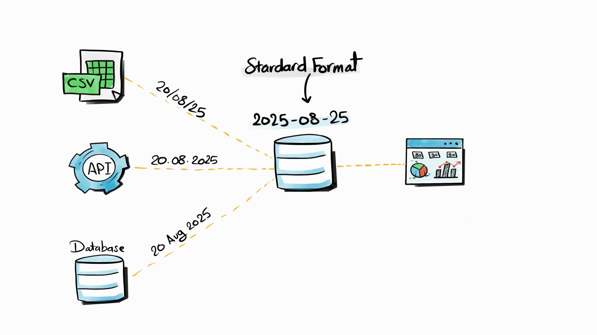

###### All Format

**Date Format**

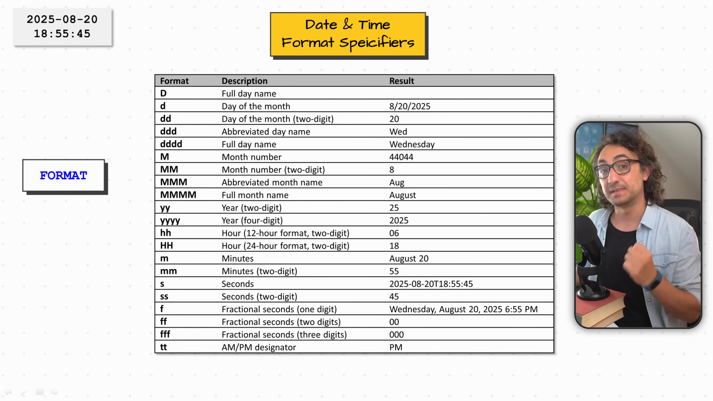

**Number Format**

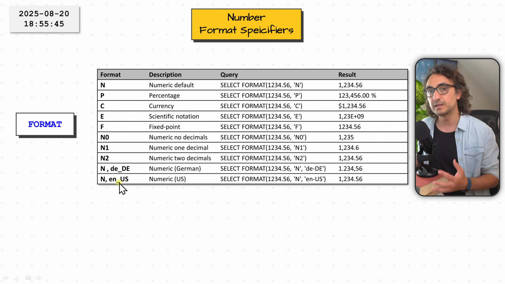

###### **Casting**

Changing the data type from one to another

###### **CONVERT**

\- Convert a date or time value to a different data type(CASTING) & Fomrat the value(FORMATTING)
\- Syntax: CONVERT(data_type, value, [, style ]) where third parameter is optional
\- Example: CONVERT(INT, '124') or CONVERT(VARCHAR, Orderdate, '34')

```sql
SELECT
    o.CreationTime ,
    CONVERT(Date, o.CreationTime ) AS [Datetime To Date CONVERT],
    CONVERT(VARCHAR, o.CreationTime, 32) AS [USA Std. Style:32], -- casting and Formart
    CONVERT(VARCHAR, o.CreationTime , 34) AS [EUROPE STD. Style:34]
FROM Sales.Orders o

```

| CreationTime            | Datetime To Date CONVERT | USA Std. Style:32 | EUROPE STD. Style:34 |
| ----------------------- | ------------------------ | ----------------- | -------------------- |
| 2025-01-01 12:34:56.000 | 2025-01-01               | 01-01-2025        | 01-01-2025           |
| 2025-01-05 23:22:04.000 | 2025-01-05               | 01-05-2025        | 05-01-2025           |
| 2025-01-10 18:24:08.000 | 2025-01-10               | 01-10-2025        | 10-01-2025           |
| 2025-01-20 05:50:33.000 | 2025-01-20               | 01-20-2025        | 20-01-2025           |
| 2025-02-01 14:02:41.000 | 2025-02-01               | 02-01-2025        | 01-02-2025           |
| 2025-02-06 15:34:57.000 | 2025-02-06               | 02-06-2025        | 06-02-2025           |
| 2025-02-16 06:22:01.000 | 2025-02-16               | 02-16-2025        | 16-02-2025           |
| 2025-02-18 10:45:22.000 | 2025-02-18               | 02-18-2025        | 18-02-2025           |
| 2025-03-10 12:59:04.000 | 2025-03-10               | 03-10-2025        | 10-03-2025           |
| 2025-03-16 23:25:15.000 | 2025-03-16               | 03-16-2025        | 16-03-2025           |

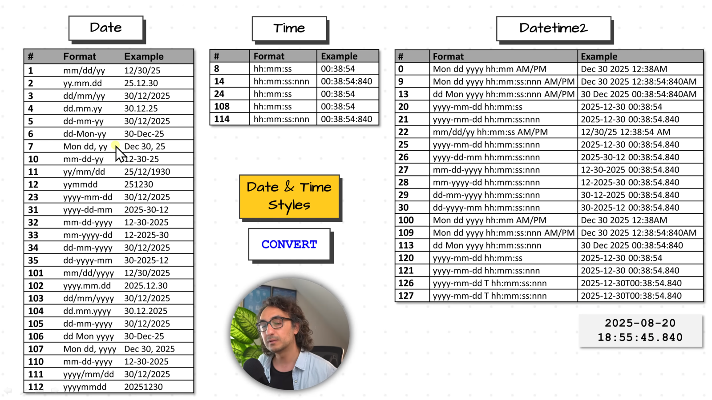

###### **CAST**

\- Convert a value to specific data type.
\- Syntax: CAST(value as DATA_TYPE)
\- Example: CAST('123' AS INT) or CAST('2026-05-08' AS DATE)
\- We can use CAST function to only change data type we cannot change format.

```sql
SELECT
    o.CreationTime,
    CAST(123 AS VARCHAR) AS [Int to String],
    CAST(o.CreationTime AS DATE) AS [DateTime to Date],
    CAST('2025-08-20' AS DATE) AS [String to Date]
FROM Sales.Orders o
```

| CreationTime            | Int to String | DateTime to Date | String to Date |
| ----------------------- | ------------- | ---------------- | -------------- |
| 2025-01-01 12:34:56.000 | 123           | 2025-01-01       | 2025-08-20     |
| 2025-01-05 23:22:04.000 | 123           | 2025-01-05       | 2025-08-20     |
| 2025-01-10 18:24:08.000 | 123           | 2025-01-10       | 2025-08-20     |
| 2025-01-20 05:50:33.000 | 123           | 2025-01-20       | 2025-08-20     |
| 2025-02-01 14:02:41.000 | 123           | 2025-02-01       | 2025-08-20     |
| 2025-02-06 15:34:57.000 | 123           | 2025-02-06       | 2025-08-20     |
| 2025-02-16 06:22:01.000 | 123           | 2025-02-16       | 2025-08-20     |
| 2025-02-18 10:45:22.000 | 123           | 2025-02-18       | 2025-08-20     |
| 2025-03-10 12:59:04.000 | 123           | 2025-03-10       | 2025-08-20     |
| 2025-03-16 23:25:15.000 | 123           | 2025-03-16       | 2025-08-20     |

###### **FORMAT VS CONVERT VS CAST**

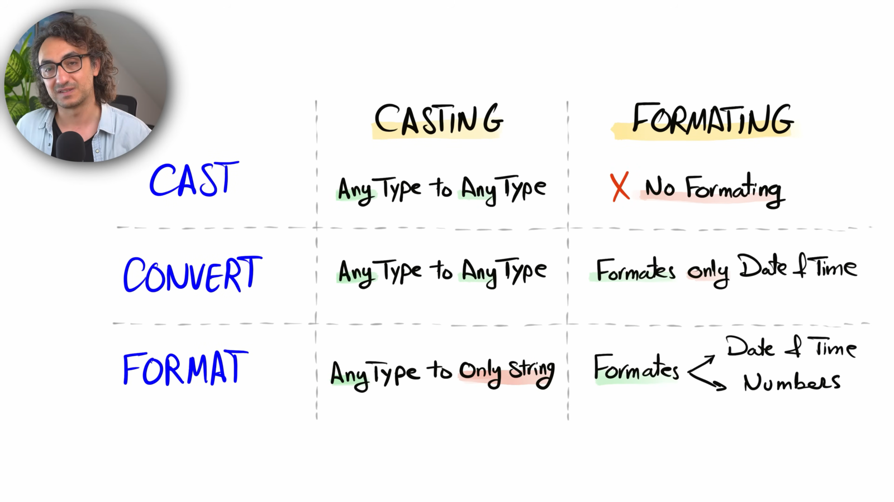

##### Date Calculation

###### **DATEADD**

\- Add or Subtracts a specific time interval to/from a date.

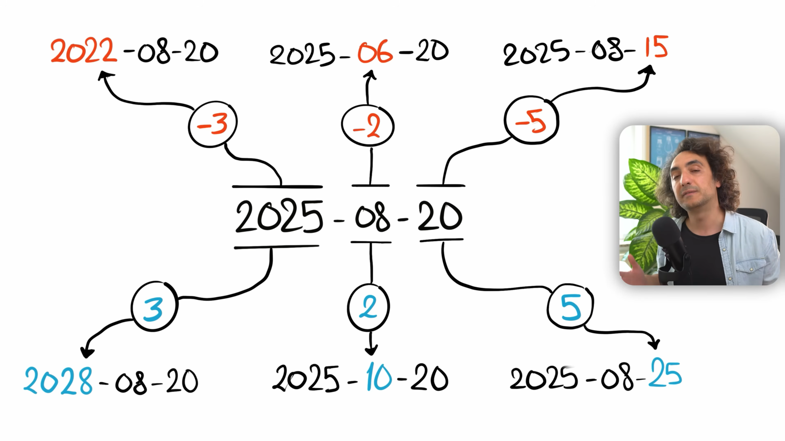

\- Syntax: DATEADD(part, interval, date)
\- Example: DATEADD(year, 2, OrderDate) or DATEADD(month, -4, OrderDate)

```sql
-- DATEADD
SELECT
    o.OrderID ,
    o.OrderDate ,
    DATEADD(year, 2, o.OrderDate ) AS TwoYearsLater,
    DATEADD(month, 3, o.OrderDate ) AS ThreeMonthLater,
    DATEADD(day, -10, o.OrderDate ) AS BeforeTenDay
FROM Sales.Orders o
```

| OrderID | OrderDate  | TwoYearsLater | ThreeMonthLater | BeforeTenDay |
| ------- | ---------- | ------------- | --------------- | ------------ |
| 1       | 2025-01-01 | 2027-01-01    | 2025-04-01      | 2024-12-22   |
| 2       | 2025-01-05 | 2027-01-05    | 2025-04-05      | 2024-12-26   |
| 3       | 2025-01-10 | 2027-01-10    | 2025-04-10      | 2024-12-31   |
| 4       | 2025-01-20 | 2027-01-20    | 2025-04-20      | 2025-01-10   |
| 5       | 2025-02-01 | 2027-02-01    | 2025-05-01      | 2025-01-22   |
| 6       | 2025-02-05 | 2027-02-05    | 2025-05-05      | 2025-01-26   |
| 7       | 2025-02-15 | 2027-02-15    | 2025-05-15      | 2025-02-05   |
| 8       | 2025-02-18 | 2027-02-18    | 2025-05-18      | 2025-02-08   |
| 9       | 2025-03-10 | 2027-03-10    | 2025-06-10      | 2025-02-28   |
| 10      | 2025-03-15 | 2027-03-15    | 2025-06-15      | 2025-03-05   |

###### **DATEDIFF**

\- Find the difference between two date
\- Syntax: DATEDIFF(part, start_date, end_date)

**Task-1**

```sql
-- Calculate the age of employee
SELECT
    e.EmployeeID ,
    e.BirthDate ,
    DATEDIFF(year, e.BirthDate , GETDATE()) AS employee_age
FROM Sales.Employees e;
```

| EmployeeID | BirthDate  | employee_age |
| ---------- | ---------- | ------------ |
| 1          | 1988-12-05 | 38           |
| 2          | 1972-11-25 | 54           |
| 3          | 1986-01-05 | 40           |
| 4          | 1977-02-10 | 49           |
| 5          | 1982-02-11 | 44           |

**Task-2**

```sql
-- Find the average shipping duration in days for each month
SELECT
    MONTH(o.OrderDate) as order_date,
    AVG(DATEDIFF(day, o.OrderDate , o.ShipDate )) AS avg_ship
FROM Sales.Orders o
GROUP BY MONTH(o.OrderDate )
```

| order_date | avg_ship |
| ---------- | -------- |
| 1          | 7        |
| 2          | 7        |
| 3          | 5        |

**Task-3**

> LAG Window function can be used to access value from the previous row

```sql
-- Time Gap Analysis
-- Find the number of days between order and previous order
SELECT
    o.OrderID ,
    o.OrderDate AS current_order_date,
    LAG(o.OrderDate ) OVER (ORDER BY o.OrderDate ) AS Previous_order_date,
    DATEDIFF(day, LAG(o.OrderDate ) OVER (ORDER BY o.OrderDate ), o.OrderDate ) As no_of_days
FROM Sales.Orders o
```

| OrderID | current_order_date | Previous_order_date | no_of_days |
| ------- | ------------------ | ------------------- | ---------- |
| 1       | 2025-01-01         | NULL                | NULL       |
| 2       | 2025-01-05         | 2025-01-01          | 4          |
| 3       | 2025-01-10         | 2025-01-05          | 5          |
| 4       | 2025-01-20         | 2025-01-10          | 10         |
| 5       | 2025-02-01         | 2025-01-20          | 12         |
| 6       | 2025-02-05         | 2025-02-01          | 4          |
| 7       | 2025-02-15         | 2025-02-05          | 10         |
| 8       | 2025-02-18         | 2025-02-15          | 3          |
| 9       | 2025-03-10         | 2025-02-18          | 20         |
| 10      | 2025-03-15         | 2025-03-10          | 5          |

##### Validation

###### ISDATE

\- Check if a value is a date.
\- Return 1 if the string is a valid date. otherwise return 0
\- Syntax: ISDATE(value)

**Example-01**

```sql
SELECT
    ISDATE('123') DateCheck1,
    ISDATE('2025-08-20') DateCheck2,
    ISDATE('20-08-2025') DateCheck3, -- isn't valid because it doesn't follow database standard
    ISDATE('2025') DateCheck4,
    ISDATE('08') DateCheck5

```

| DateCheck1 | DateCheck2 | DateCheck3 | DateCheck4 | DateCheck5 |
| ---------- | ---------- | ---------- | ---------- | ---------- |
| 0          | 1          | 0          | 1          | 0          |

**Example-02**

```sql
-- we can use ISDATE to check data quality issue
SELECT
    --CAST(OrderDate AS DATE) OrderDate,
    t.OrderDate,
    ISDATE(t.OrderDate ) AS is_date,
    CASE WHEN ISDATE(t.OrderDate) = 1 THEN CAST(OrderDate As Date)
    ELSE '9999-01-01'
    END NewOrderDate
FROM (
    SELECT '2025-08-20' AS OrderDate UNION
    SELECT '2025-08-21' UNION
    SELECT '2025-08-23' UNION
    SELECT '2025-08'
) t
-- WHERE ISDATE(t.OrderDate ) = 0    --we can use to filter invalid date value form the result
```

| OrderDate  | is_date | NewOrderDate |
| ---------- | ------- | ------------ |
| 2025-08    | 0       | 9999-01-01   |
| 2025-08-20 | 1       | 2025-08-20   |
| 2025-08-21 | 1       | 2025-08-21   |
| 2025-08-23 | 1       | 2025-08-23   |

> So, We can use ISDATE function for date clean up.

#### Null Functions

###### **What is NULL?**

- NULL means nothing, unknown!
- NULL is not equal to anything!
    - NULL is not zero
    - NULL is not empty string
    - NULL is not blank space
- NULL tells us there is no value and it is missing
- NULL is not a data type in SQL, it is just a special marker, placeholder or state which indicates that a data does not exist in a database.

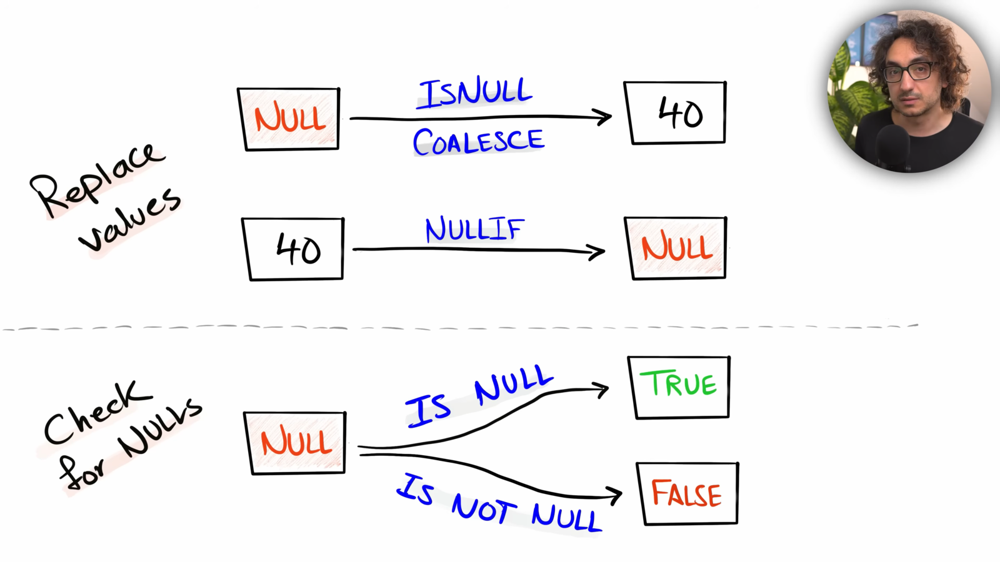

###### **ISNULL**

\- Replace 'NULL' with a specified value
\- Syntax: ISNULL(value, replacement_value); here value is column name
\- Example: ISNULL(Shipping_Address, 'unknown')
\- Here we are going to check Shipping_Address column and if we find the null value then we are going to replace that with default value 'unknown'. here we are replacing the null value with static value.

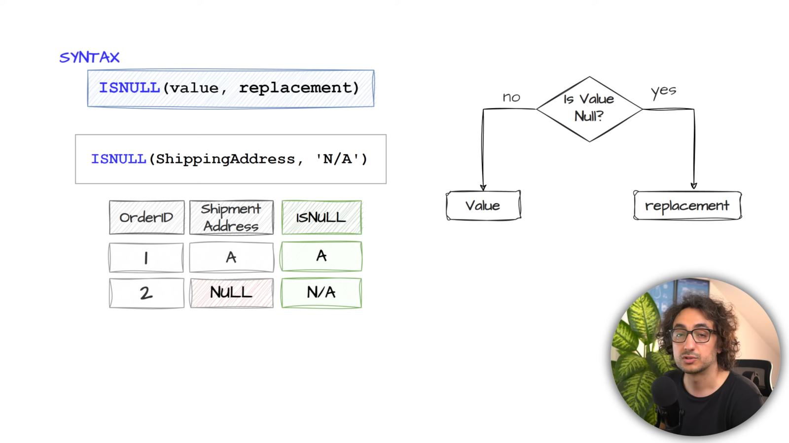

\- Example: ISNULL(Shipping_Address, Billing_Address)
\- Here we are going to check the value of shipping address and if we find any null value then we are going to replace the null value from billing_address column. here we have both column value. and we are going to replace null with the help of another column

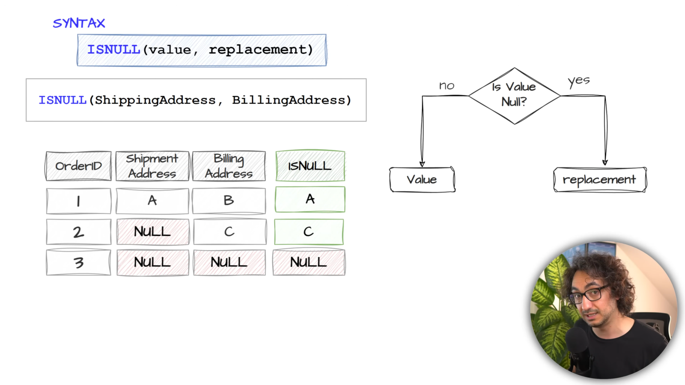

If we are going to replace null with using another column then we may end up with null if the replacement table value is also null. so if we don't want to end up with null in the result we can use static value to replace null.

###### **COALESCE**

\- Return the first non-null value from the list
\- COALESCE(value1, value2, value3, ...)

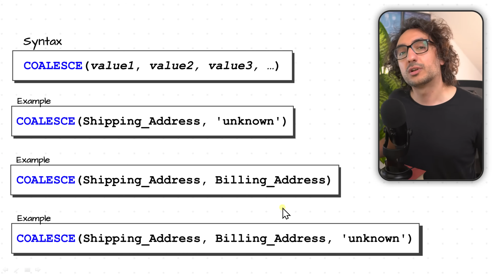

**How COALESCE works?**

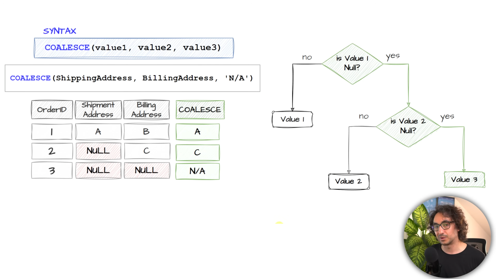

###### **NULL VS COALESCE**

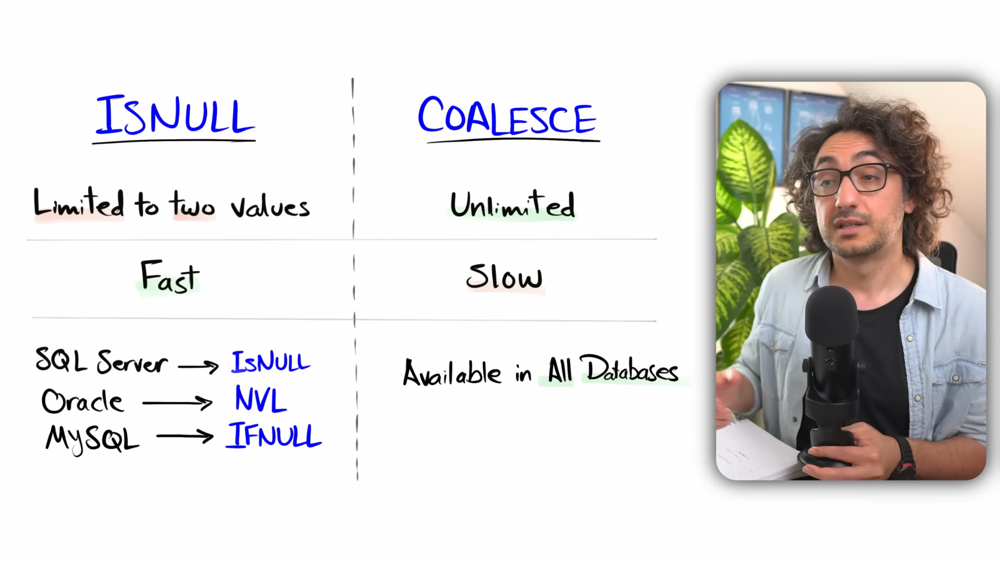

> Try to use COALESCE as much as possible until you have slow query performance.

###### **NULLIF**

\- Compare two expressions return:
- NULL, if they are equal.
- First Value, if they are not equal.
\- Syntax: NULLIF(value1, value2)
\- Example: NULLIF(Shipping_Address, 'unknown')
\- Example: NULLIF(Shipping_Address, Billing_Address)

**Example-1**

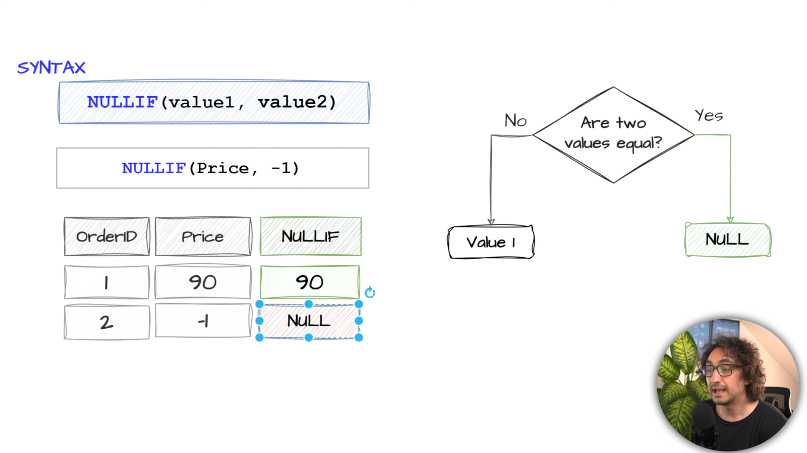

In this example we are checking if there is any invalid price. so we are replacing invalid price with null value.

**Example-2**

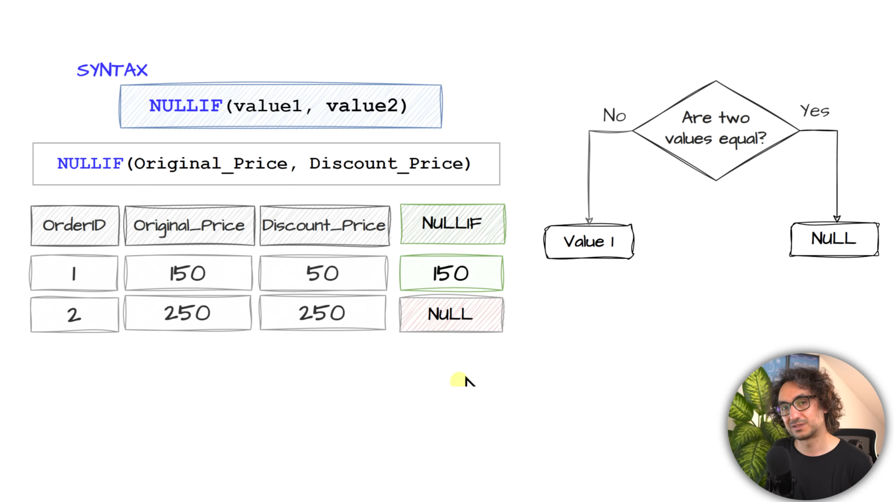

We can use NULLIF to check for inconsistent data.

**NULLIF Use Case: Division By Zero**

\- preventing the error of dividing by zero

**Example-3**

```sql
-- Find the sale price for each order by dividing the sales by the equity
SELECT
    o.OrderId ,
    o.Sales ,
    o.Quantity ,
    o.Sales / NULLIF(o.Quantity, 0) AS Price
FROM Sales.Orders o ;
```

| OrderId | Sales | Quantity | Price |
| ------- | ----- | -------- | ----- |
| 1       | 10    | 1        | 10    |
| 2       | 15    | 1        | 15    |
| 3       | 20    | 2        | 10    |
| 4       | 60    | 2        | 30    |
| 5       | 25    | 1        | 25    |
| 6       | 50    | 2        | 25    |
| 7       | 30    | 2        | 15    |
| 8       | 90    | 3        | 30    |
| 9       | 20    | 2        | 10    |
| 10      | 60    | 0        | NULL  |

###### **IS NULL & IS NOT NULL**

**IS NULL**

\- Return TRUE if the value is NULL otherwise return FALSE
\- Syntax: Value IS NULL
\- Example: Shipping_Address IS NULL

**IS NOT NULL**

\- Return TRUE if the value IS NOT NULL, otherwise it return FALSE.
\- Syntax: Value IS NOT NULL
\- Example: Shipping_Address IS NOT NULL

**IS NULL Use Case**

**#1 Filtering Data**

\- Searching for missing information or searching for null.

**Example-1**

```sql
-- Identify the customers who have no score.
SELECT
    *
FROM Sales.Customers c
WHERE c.Score IS NULL;
```

| CustomerID | FirstName | LastName | Country | Score |
| ---------- | --------- | -------- | ------- | ----- |
| 5          | Anna      | Adams    | USA     | NULL  |

**Example-2**

```sql
-- List all customers who have scores
SELECT
    *
FROM Sales.Customers c
WHERE c.Score IS NOT NULL;
```

| CustomerID | FirstName | LastName | Country | Score |
| ---------- | --------- | -------- | ------- | ----- |
| 1          | Jossef    | Goldberg | Germany | 350   |
| 2          | Kevin     | Brown    | USA     | 900   |
| 3          | Mary      | NULL     | USA     | 750   |
| 4          | Mark      | Schwarz  | Germany | 500   |

**#2 Anti Joins**

\- Finding the unmatched rows between two tables.

```sql
-- List all details for customers who have not placed any orders
SELECT
    c.CustomerID ,
    c.FirstName ,
    o.OrderID ,
    o.OrderDate
FROM Sales.Customers c
LEFT JOIN Sales.Orders o
    ON c.CustomerID = o.CustomerID
WHERE o.CustomerID IS NULL
```

| CustomerID | FirstName | OrderID | OrderDate |
| ---------- | --------- | ------- | --------- |
| 5          | Anna      | NULL    | NULL      |

###### **NULL vs Empty vs Space**

**NULL**

\- Null means nothing, unknown!

**Empty**

\- String value which has zero characters

**Space**

\- Space value has one or more space characters.

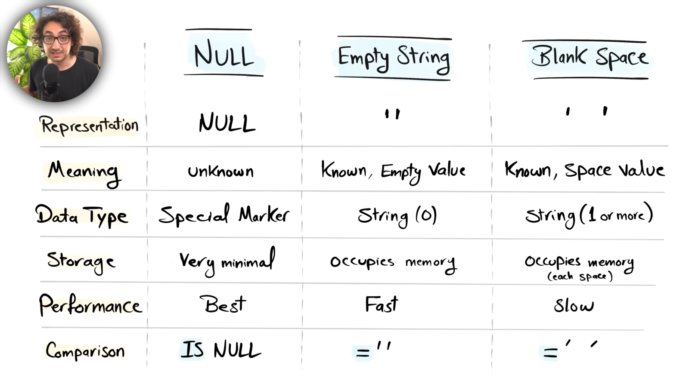

###### **Handling NULLS**

**Data Policies**

\- Set of rules that defines how data should be handled.

**#1 Data Policy**

- only use NULLs and empty strings, but avoid using blank spaces.

**#2 Data Policy**

- only use NULLs and avoid using empty strings and blank spaces.
- Use Case: Replacing empty string and blanks with NULL during data preparation before inserting into database to optimize storage and performance.

**#3 Data Policy**

- Use the default value 'unknown' and avoid using NULLs, empty strings and blank spaces.
- Use Case: Replacing empty string, NULL and blanks with default value during data preparation before using it in reporting to improve readiblity and reduce confusion.

**Example**

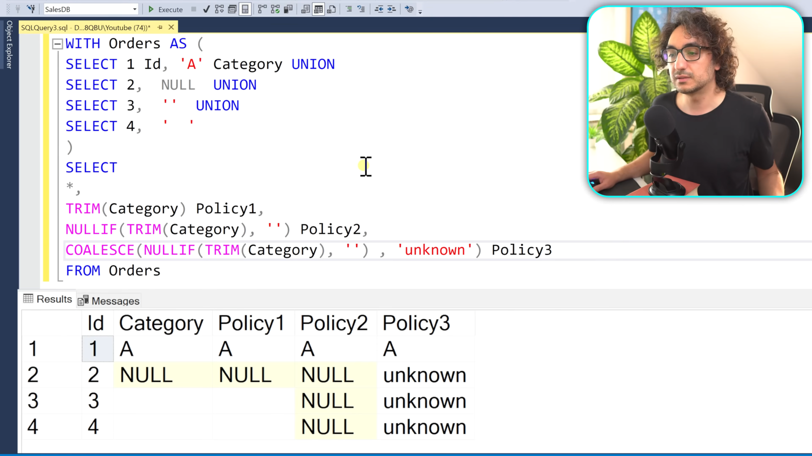

###### **Use Case: Handling NULLS**

**Data Aggregation**

\- we can use ISNULL or COALESCE to handle the null before doing data aggregations.

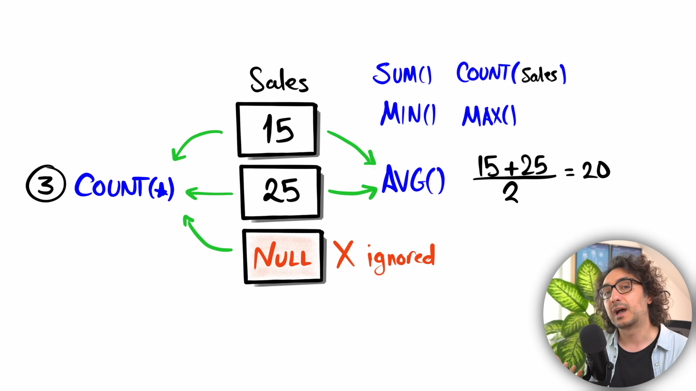

If we try to calculate avg or min or max then we can get misleading result because we want to treat null as 0 but aggregate function ignore null except COUNT. so we can replace null with 0 using ISNULL or COALESCE to get accurate results.

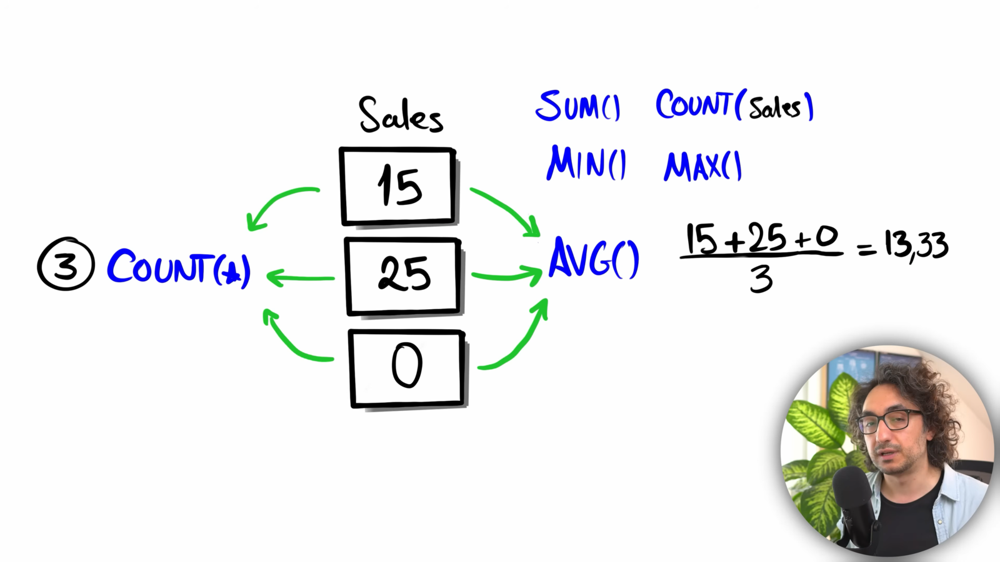

```sql
-- Find the average scores of the customers.
SELECT
    c.CustomerID ,
    c.Score ,
    COALESCE(c.Score, 0) AS score2,
    AVG(c.Score) OVER() AS average_score2,
    AVG(COALESCE(Score, 0)) OVER () AS average_score
FROM Sales.Customers c ;
```

| CustomerID | Score | score2 | average_score2 | average_score |
| ---------- | ----- | ------ | -------------- | ------------- |
| 1          | 350   | 350    | 625            | 500           |
| 2          | 900   | 900    | 625            | 500           |
| 3          | 750   | 750    | 625            | 500           |
| 4          | 500   | 500    | 625            | 500           |
| 5          | NULL  | 0      | 625            | 500           |

> The primary difference between AVG() and AVG() OVER() lies in how they process rows and shape the final query output:
>
> - AVG() (Aggregate Function): Combines multiple rows into a single summary row per group (when used with GROUP BY), reducing the total number of rows returned in the result set.
> - AVG() OVER() (Window Function): Calculates the average across a set of related rows while retaining all original row-level details

**Mathematical Operations**

\- handle the null before doing mathematical operations.
\- we get NULL + 5 = NULL and NULL + 'B' = NULL. Adding anything to null we get result as a null.

```sql
-- Display the full name of the customer in a single field by merging their firstname and lastnames,
-- and add 10 bonus points to each customer's score.
SELECT
    c.CustomerID ,
    c.FirstName ,
    c.LastName ,
    c.FirstName  +  COALESCE(c.LastName, '') AS fullname,
    c.Score ,
    COALESCE(c.Score, 0) + 10 AS score_with_bonus_points
FROM Sales.Customers c
```

| CustomerID | FirstName | LastName | fullname       | Score | score_with_bonus_points |
| ---------- | --------- | -------- | -------------- | ----- | ----------------------- |
| 1          | Jossef    | Goldberg | JossefGoldberg | 350   | 360                     |
| 2          | Kevin     | Brown    | KevinBrown     | 900   | 910                     |
| 3          | Mary      | NULL     | Mary           | 750   | 760                     |
| 4          | Mark      | Schwarz  | MarkSchwarz    | 500   | 510                     |
| 5          | Anna      | Adams    | AnnaAdams      | NULL  | 10                      |

**JOINS**

\- Handle the NULL before JOINING TABLES

**Example**

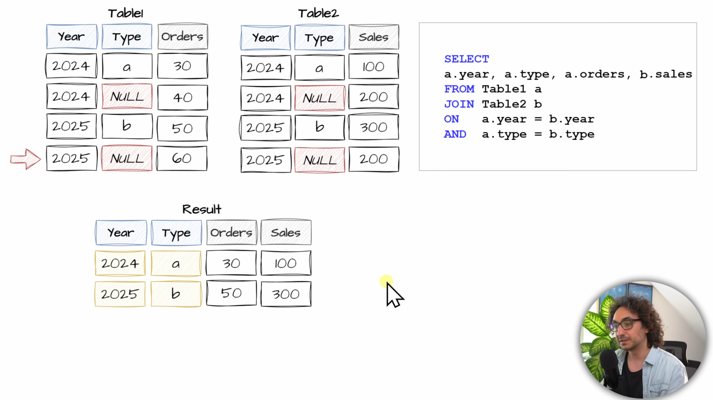

We are going to lose record in the output if have null inside our key. So, it is important to handle NULL inside the key before doing joins. So, we are going to handle the null by replacing it with empty string before doing joins.

**Solution**

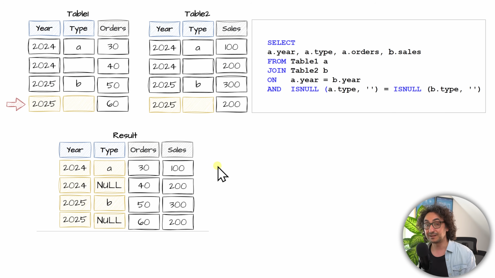

So, to get complete result without losing any records when joining the table we can use ISNULL function to check key.

**Sorting Data**

\- Handle the NULL before sorting the data.

**Example**

```sql
-- Sort the customers from lowest to highest scores with NULL appearing at last.
SELECT
    c.CustomerID ,
    c.Score
FROM Sales.Customers c
ORDER BY CASE WHEN c.Score IS NULL THEN 1 ELSE 0 END, c.score
```

| CustomerID | Score |
| ---------- | ----- |
| 1          | 350   |
| 4          | 500   |
| 3          | 750   |
| 2          | 900   |
| 5          | NULL  |

###### **Null Functions: Summary**

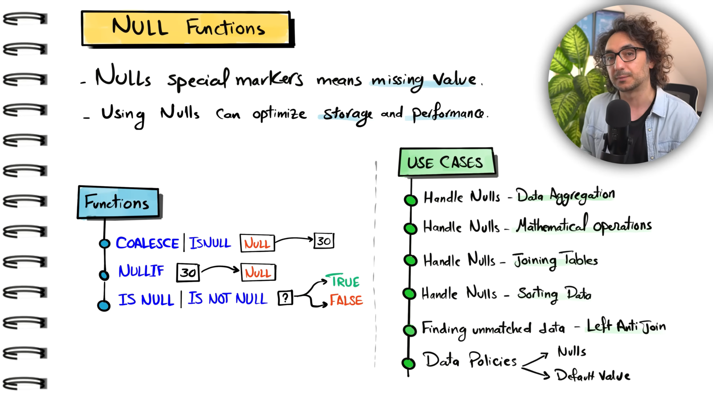
