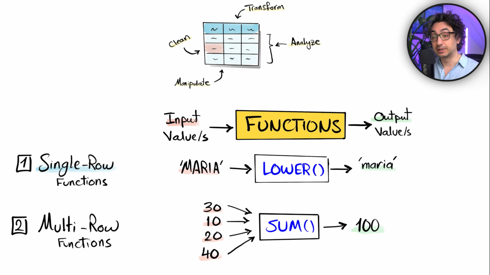
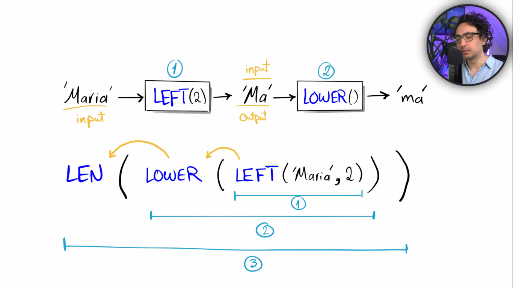
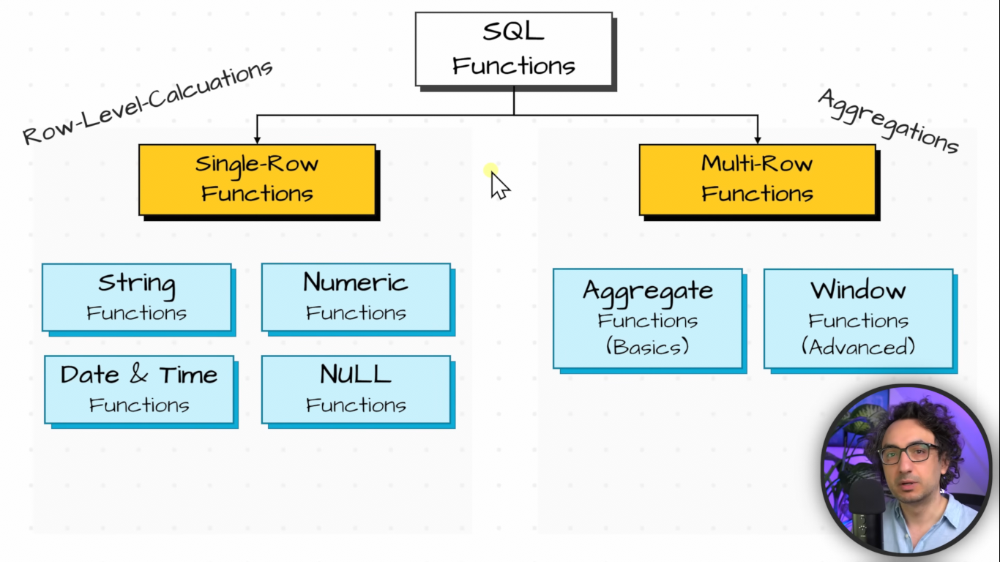
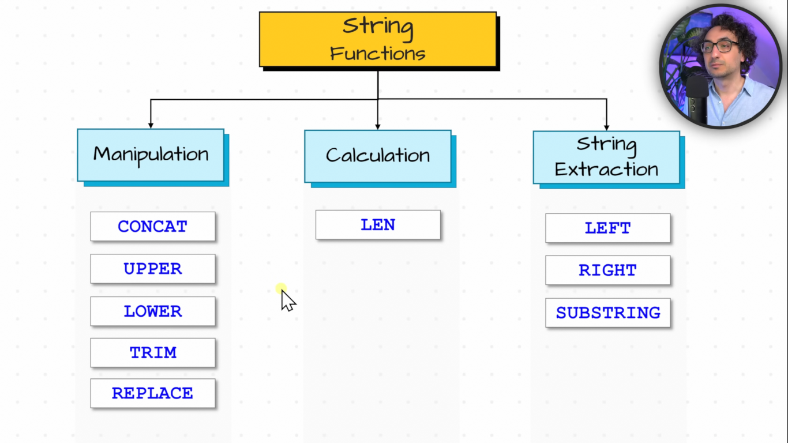
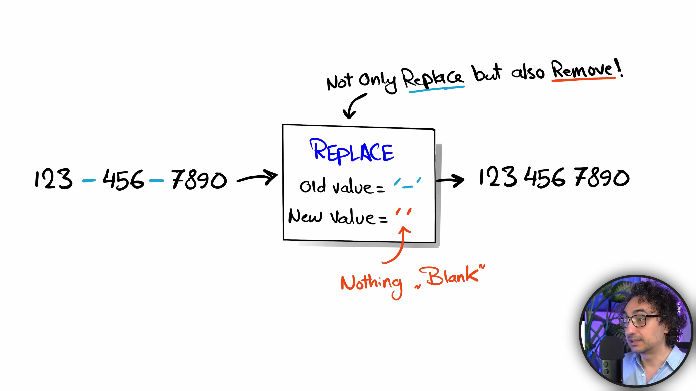
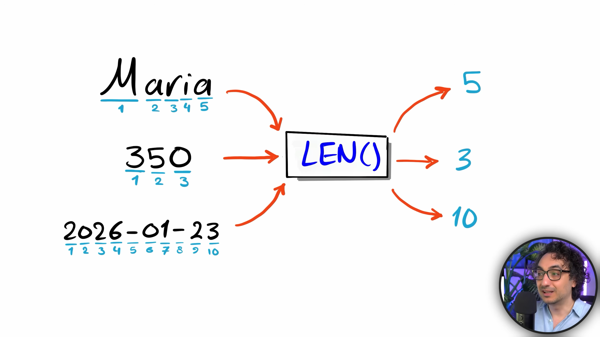
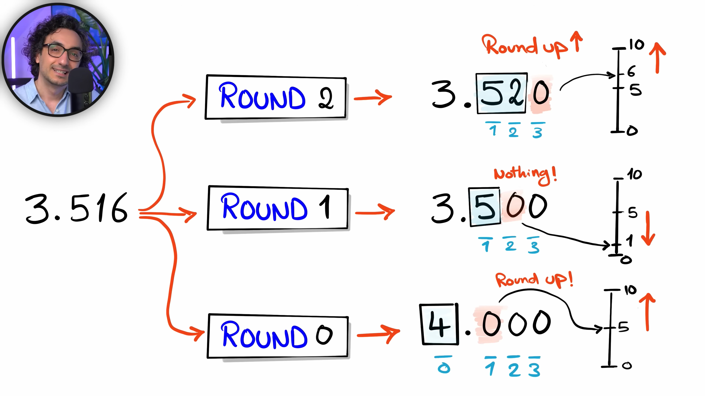

## SQL functions

← Previous: [Set Operators](../set-operators/set-operators.md) | [Index](../README.md) | Next → [Practice (sql/)](../sql)

We have data inside table and we can perform different operation on data like we can change the value of the data like doing data manipulation, data analysis to generate report or find insights, data cleaning or data transformation in order to solve some sql task. and in sql to solve this task we have functions.

**What is functions?
\- A Built in SQL code:
- accept an input value
- process it
- returns an output value



**Nested Functions**
\- Function use inside another function.


### Types of SQL Functions


#### Single-Row Function (Row-Level-Calculation)
##### String Functions


**Manipulation**
###### **CONCAT**
\- Combine multiple string into one.
**Example**
```sql
-- Concatenate first name and country into one column
SELECT 
	c.first_name,
	c.country,
	CONCAT(c.first_name , '-' ,c.country ) AS name_country
FROM customers c;
```
###### **LOWER & UPPER**
**Example**
```sql
-- convert the customer first name to lowercase
SELECT 
	c.first_name,
	LOWER(c.first_name) AS low_name
FROM customers c ;

-- conver the customer first name to uppercase
SELECT 
	c.first_name,
	UPPER(c.first_name )
FROM customers c ;
```
###### **TRIM**
\- Remove Leading and Trailing spaces.
**Example**
```sql
-- find customers whose first name contains leading or trailing spaces
SELECT 
	c.first_name,
	LEN(c.first_name) AS len_name,
	LEN(TRIM(c.first_name)) AS len_trim_name,
	LEN(c.first_name) - LEN(TRIM(c.first_name )) AS flag
FROM customers c 
--WHERE LEN(c.first_name) <> LEN(TRIM(c.first_name ))
WHERE c.first_name <> TRIM(c.first_name);
```

###### **REPLACE**
\- Replace specific character with a new character
\- It not only replace but can be used to remove the value.


**Example**
```sql
-- Remove dashes (-) from a phone number
SELECT 
	'123-246-464' AS phone_number,
	REPLACE('123-246-464', '-', '/') AS clean_phone
	
-- Replace File Extension from txt to csv
SELECT 
	'reports.txt' AS old_filename,
	 REPLACE('reports.txt', '.txt', '.csv') 
```
**Calculation**
###### **LEN**
\- Count how many characters
\- Can be used with number, character and date


**Example**
```sql
-- Calcualte the length of each customers first name
SELECT 
	c.first_name,
	LEN(c.first_name) AS len_name
FROM customers c 
```
**String Extraction**
###### **LEFT**
\- Extract specific number of characters from the start
\- Syntax: LEFT(value,  length)
###### **RIGHT**
\- Extract specific number of characters from the end
\- Syntax: RIGHT(value,  length)

**Example**
```sql
-- Retrieve the first two characters of each first name
SELECT 
	c.first_name,
	LEFT(TRIM(c.first_name), 2) AS first_two_char
FROM customers c 

-- Retrieve the last two characters of each first name
SELECT 
	c.first_name,
	RIGHT(c.first_name , 2) AS last_two_char
FROM customers c 
```
###### **SUBSTRING**
\- Extract a part of a string at a specified position
\- Syntax: SUBSTRING(value, start, length)

**Example**
```sql
-- Retrieve a list of customer's first name removing the first character
SELECT 
	c.first_name,
	SUBSTRING(TRIM(c.first_name), 2, LEN(c.first_name)) AS sub_name
FROM customers c 
```
##### Number Functions
###### **ROUND**


**Example**
```sql
SELECT 
	3.516,
	ROUND(3.516, 2) AS round_2,
	ROUND(3.516, 1) AS round_1,
	ROUND(3.516, 0) AS round_0
```
###### **ABS**
\- Convert negative number to positive

**Example**
```sql
SELECT 
	-10,
	ABS(-10),
	ABS(10)
```
##### Date & Time Functions
