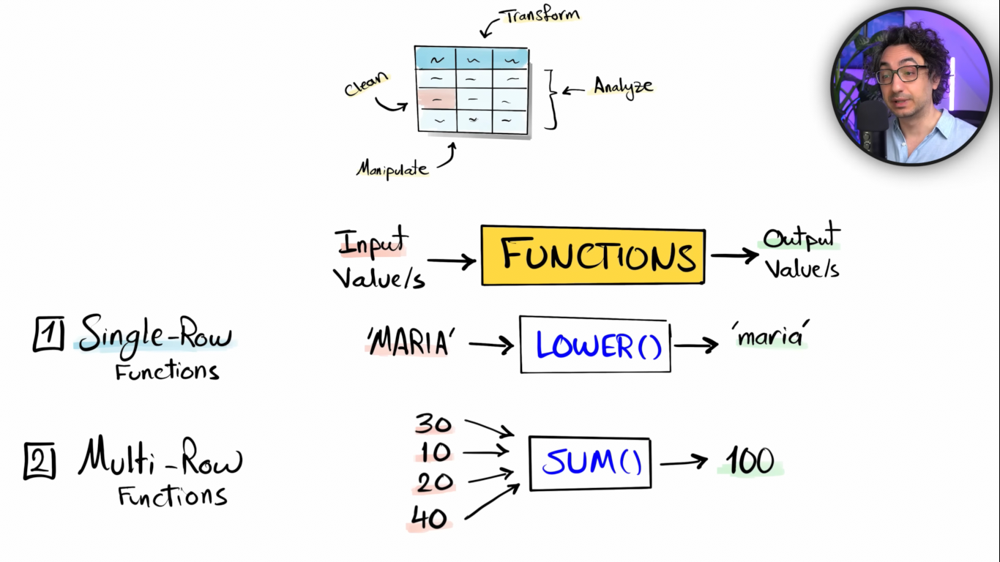
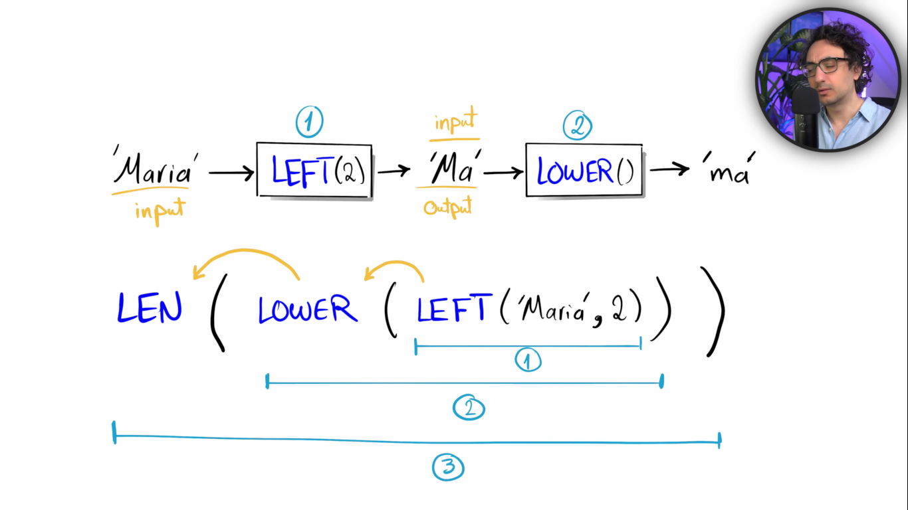
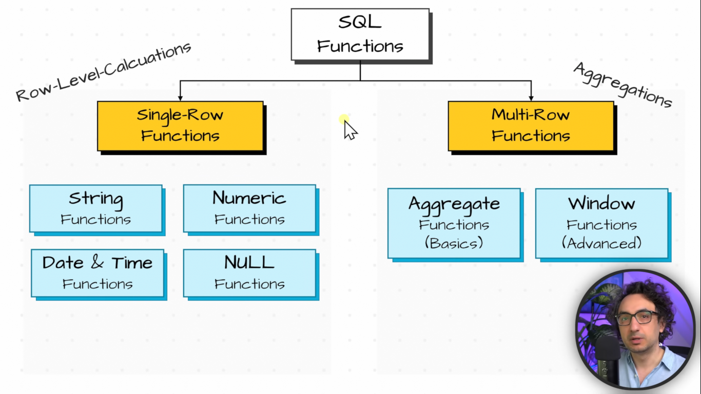

## SQL Functions

← Previous: [Set Operators](../set-operators/set-operators.md) | [Index](../README.md) | Next → [Single-Row Functions](single-row-functions.md)

We have data inside table and we can perform different operation on data like we can change the value of the data like doing data manipulation, data analysis to generate report or find insights, data cleaning or data transformation in order to solve some sql task. and in sql to solve this task we have functions.

**What is functions?**

\- A Built in SQL code:
- accept an input value
- process it
- returns an output value

**Nested Functions**

\- Function use inside another function.

### Types of SQL Functions

SQL functions are grouped into single-row functions and aggregate functions.

### Topics

- [Single-Row Functions](single-row-functions.md) — run on each row and return one value per row.
- Aggregate Functions — summarize many rows into a single value.
