## Null Functions

← Previous: [Date & Time Functions](date-time-functions.md) | [Index](../README.md) | Next → [Practice (sql/)](../sql)

#### **What is NULL?**

- NULL means nothing, unknown!
- NULL is not equal to anything!
    - NULL is not zero
    - NULL is not empty string
    - NULL is not blank space
- NULL tells us there is no value and it is missing
- NULL is not a data type in SQL, it is just a special marker, placeholder or state which indicates that a data does not exist in a database.

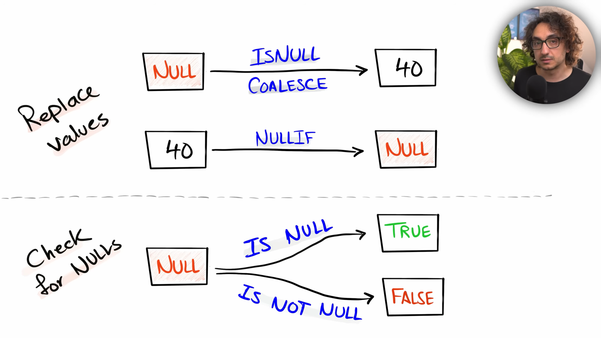

#### **ISNULL**

\- Replace 'NULL' with a specified value
\- Syntax: ISNULL(value, replacement_value); here value is column name
\- Example: ISNULL(Shipping_Address, 'unknown')
\- Here we are going to check Shipping_Address column and if we find the null value then we are going to replace that with default value 'unknown'. here we are replacing the null value with static value.

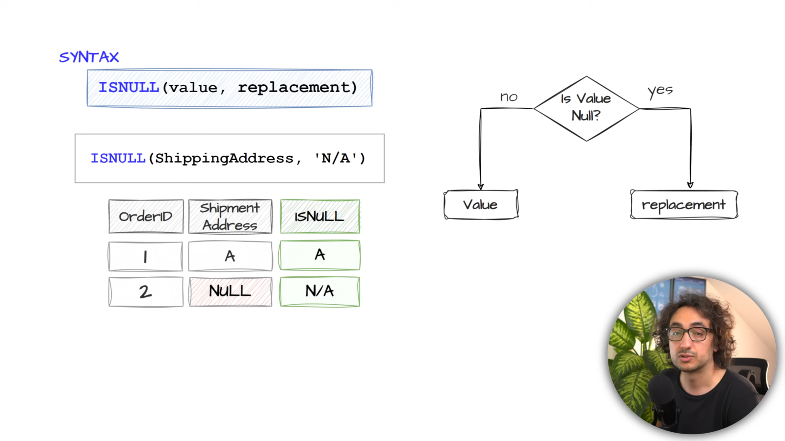

\- Example: ISNULL(Shipping_Address, Billing_Address)
\- Here we are going to check the value of shipping address and if we find any null value then we are going to replace the null value from billing_address column. here we have both column value. and we are going to replace null with the help of another column

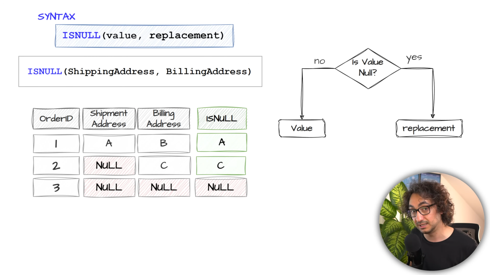

If we are going to replace null with using another column then we may end up with null if the replacement table value is also null. so if we don't want to end up with null in the result we can use static value to replace null.

#### **COALESCE**

\- Return the first non-null value from the list
\- COALESCE(value1, value2, value3, ...)

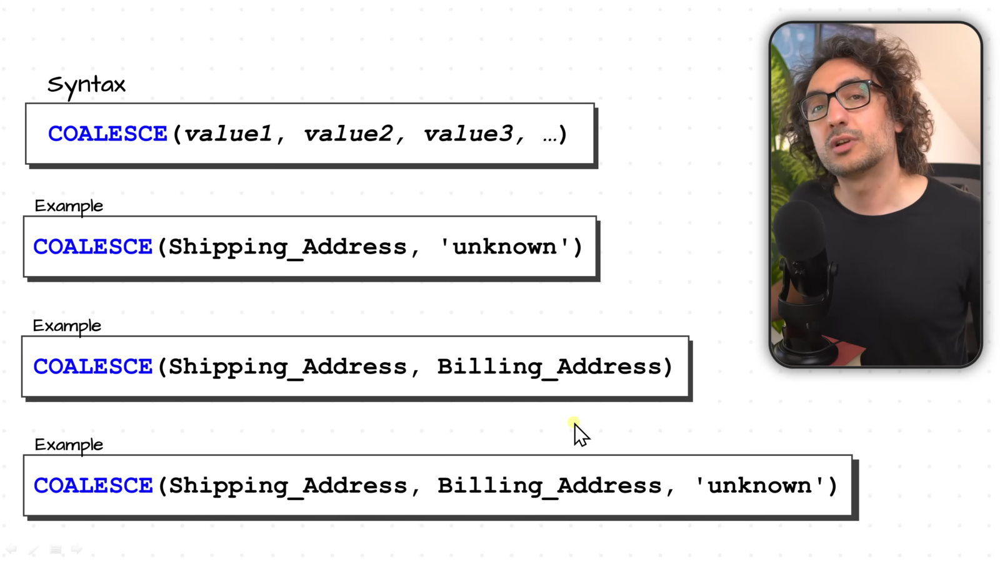

**How COALESCE works?**

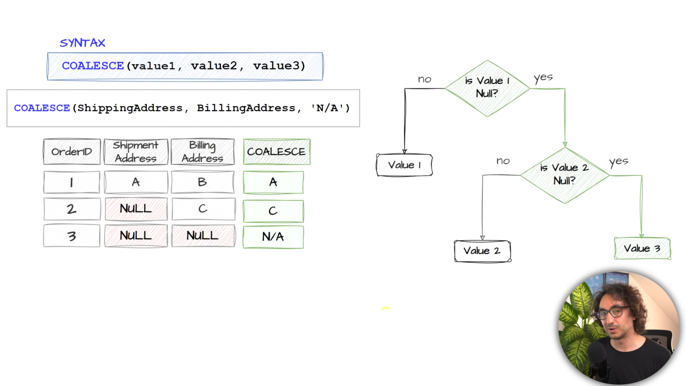

#### **NULL VS COALESCE**

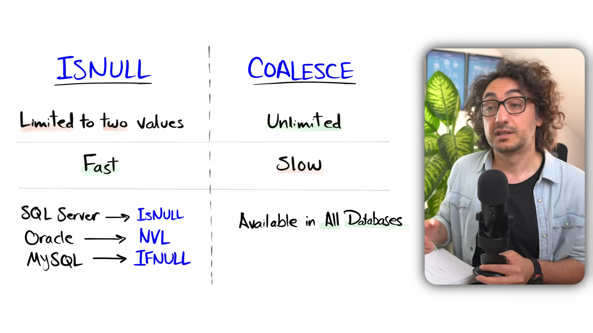

> Try to use COALESCE as much as possible until you have slow query performance.

#### **NULLIF**

\- Compare two expressions return:
- NULL, if they are equal.
- First Value, if they are not equal.
\- Syntax: NULLIF(value1, value2)
\- Example: NULLIF(Shipping_Address, 'unknown')
\- Example: NULLIF(Shipping_Address, Billing_Address)

**Example-1**

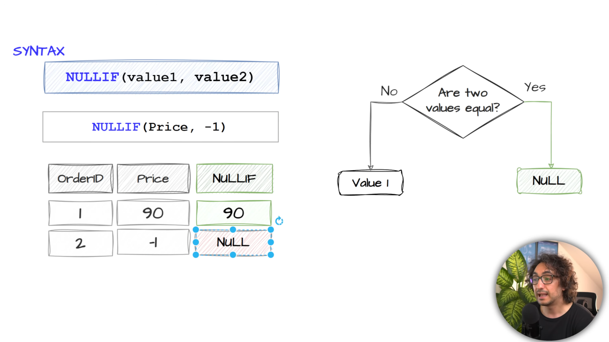

In this example we are checking if there is any invalid price. so we are replacing invalid price with null value.

**Example-2**

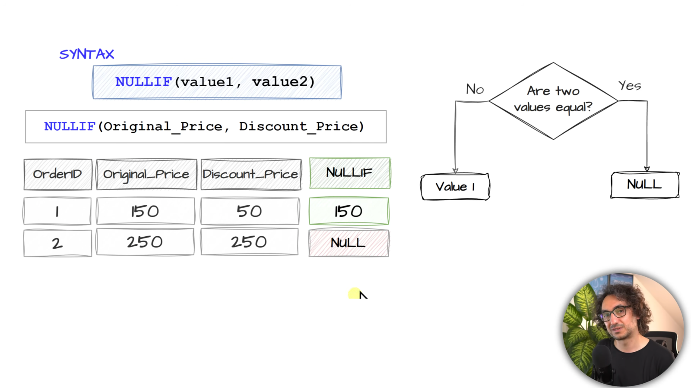

We can use NULLIF to check for inconsistent data.

**NULLIF Use Case: Division By Zero**

\- preventing the error of dividing by zero

**Example-3**

```sql
-- Find the sale price for each order by dividing the sales by the equity
SELECT
    o.OrderId ,
    o.Sales ,
    o.Quantity ,
    o.Sales / NULLIF(o.Quantity, 0) AS Price
FROM Sales.Orders o ;
```

| OrderId | Sales | Quantity | Price |
| ------- | ----- | -------- | ----- |
| 1       | 10    | 1        | 10    |
| 2       | 15    | 1        | 15    |
| 3       | 20    | 2        | 10    |
| 4       | 60    | 2        | 30    |
| 5       | 25    | 1        | 25    |
| 6       | 50    | 2        | 25    |
| 7       | 30    | 2        | 15    |
| 8       | 90    | 3        | 30    |
| 9       | 20    | 2        | 10    |
| 10      | 60    | 0        | NULL  |

#### **IS NULL & IS NOT NULL**

**IS NULL**

\- Return TRUE if the value is NULL otherwise return FALSE
\- Syntax: Value IS NULL
\- Example: Shipping_Address IS NULL

**IS NOT NULL**

\- Return TRUE if the value IS NOT NULL, otherwise it return FALSE.
\- Syntax: Value IS NOT NULL
\- Example: Shipping_Address IS NOT NULL

**IS NULL Use Case**

**#1 Filtering Data**

\- Searching for missing information or searching for null.

**Example-1**

```sql
-- Identify the customers who have no score.
SELECT
    *
FROM Sales.Customers c
WHERE c.Score IS NULL;
```

| CustomerID | FirstName | LastName | Country | Score |
| ---------- | --------- | -------- | ------- | ----- |
| 5          | Anna      | Adams    | USA     | NULL  |

**Example-2**

```sql
-- List all customers who have scores
SELECT
    *
FROM Sales.Customers c
WHERE c.Score IS NOT NULL;
```

| CustomerID | FirstName | LastName | Country | Score |
| ---------- | --------- | -------- | ------- | ----- |
| 1          | Jossef    | Goldberg | Germany | 350   |
| 2          | Kevin     | Brown    | USA     | 900   |
| 3          | Mary      | NULL     | USA     | 750   |
| 4          | Mark      | Schwarz  | Germany | 500   |

**#2 Anti Joins**

\- Finding the unmatched rows between two tables.

```sql
-- List all details for customers who have not placed any orders
SELECT
    c.CustomerID ,
    c.FirstName ,
    o.OrderID ,
    o.OrderDate
FROM Sales.Customers c
LEFT JOIN Sales.Orders o
    ON c.CustomerID = o.CustomerID
WHERE o.CustomerID IS NULL
```

| CustomerID | FirstName | OrderID | OrderDate |
| ---------- | --------- | ------- | --------- |
| 5          | Anna      | NULL    | NULL      |

#### **NULL vs Empty vs Space**

**NULL**

\- Null means nothing, unknown!

**Empty**

\- String value which has zero characters

**Space**

\- Space value has one or more space characters.

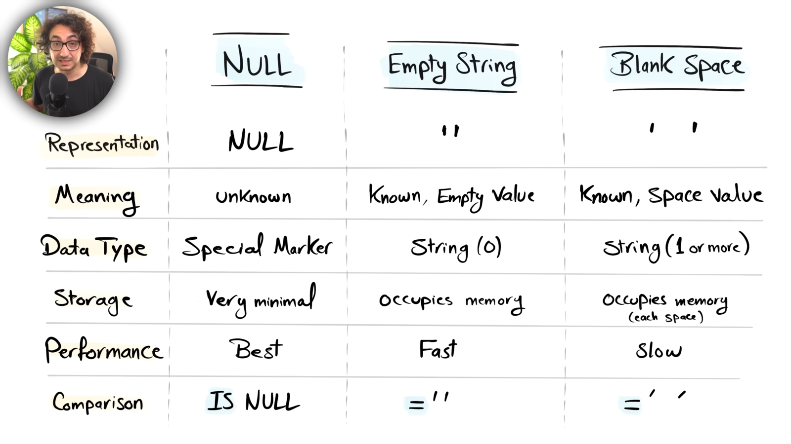

#### **Handling NULLs: Data Policies**

\- This topic is about the database side: which representation of "no value" is allowed in a column.
\- A data policy is a rule we choose during data preparation so the stored data stays consistent. It does not cover queries yet.

**Data Policies**

\- Set of rules that defines how data should be handled.

**#1 Data Policy**

- only use NULLs and empty strings, but avoid using blank spaces.

**#2 Data Policy**

- only use NULLs and avoid using empty strings and blank spaces.
- Use Case: Replacing empty string and blanks with NULL during data preparation before inserting into database to optimize storage and performance.

**#3 Data Policy**

- Use the default value 'unknown' and avoid using NULLs, empty strings and blank spaces.
- Use Case: Replacing empty string, NULL and blanks with default value during data preparation before using it in reporting to improve readiblity and reduce confusion.

**Example**

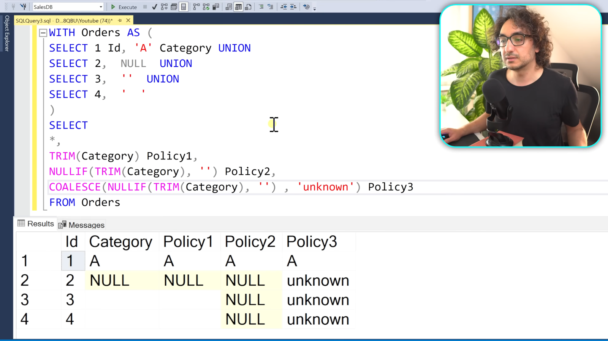

#### **Handling NULLs: Query Use Cases**

\- This topic is about the query side: NULLs already exist in the data, so we handle them while aggregating, calculating, joining and sorting so they do not give wrong or missing results.

**Data Aggregation**

\- we can use ISNULL or COALESCE to handle the null before doing data aggregations.

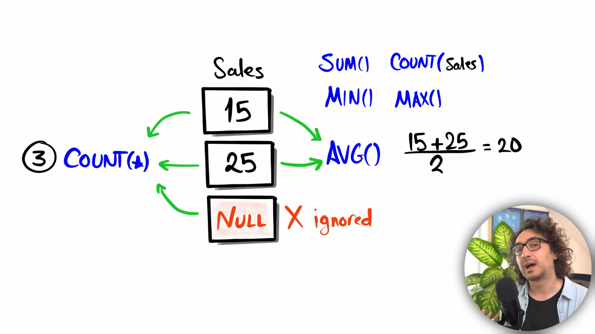

If we try to calculate avg or min or max then we can get misleading result because we want to treat null as 0 but aggregate function ignore null except COUNT. so we can replace null with 0 using ISNULL or COALESCE to get accurate results.

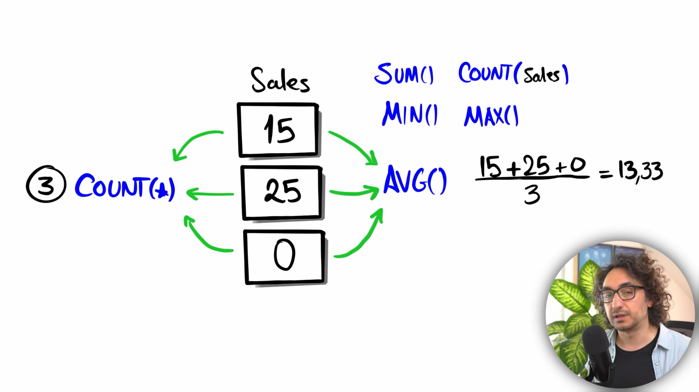

```sql
-- Find the average scores of the customers.
SELECT
    c.CustomerID ,
    c.Score ,
    COALESCE(c.Score, 0) AS score2,
    AVG(c.Score) OVER() AS average_score2,
    AVG(COALESCE(Score, 0)) OVER () AS average_score
FROM Sales.Customers c ;
```

| CustomerID | Score | score2 | average_score2 | average_score |
| ---------- | ----- | ------ | -------------- | ------------- |
| 1          | 350   | 350    | 625            | 500           |
| 2          | 900   | 900    | 625            | 500           |
| 3          | 750   | 750    | 625            | 500           |
| 4          | 500   | 500    | 625            | 500           |
| 5          | NULL  | 0      | 625            | 500           |

> The primary difference between AVG() and AVG() OVER() lies in how they process rows and shape the final query output:
>
> - AVG() (Aggregate Function): Combines multiple rows into a single summary row per group (when used with GROUP BY), reducing the total number of rows returned in the result set.
> - AVG() OVER() (Window Function): Calculates the average across a set of related rows while retaining all original row-level details

**Mathematical Operations**

\- handle the null before doing mathematical operations.
\- we get NULL + 5 = NULL and NULL + 'B' = NULL. Adding anything to null we get result as a null.

```sql
-- Display the full name of the customer in a single field by merging their firstname and lastnames,
-- and add 10 bonus points to each customer's score.
SELECT
    c.CustomerID ,
    c.FirstName ,
    c.LastName ,
    c.FirstName  +  COALESCE(c.LastName, '') AS fullname,
    c.Score ,
    COALESCE(c.Score, 0) + 10 AS score_with_bonus_points
FROM Sales.Customers c
```

| CustomerID | FirstName | LastName | fullname       | Score | score_with_bonus_points |
| ---------- | --------- | -------- | -------------- | ----- | ----------------------- |
| 1          | Jossef    | Goldberg | JossefGoldberg | 350   | 360                     |
| 2          | Kevin     | Brown    | KevinBrown     | 900   | 910                     |
| 3          | Mary      | NULL     | Mary           | 750   | 760                     |
| 4          | Mark      | Schwarz  | MarkSchwarz    | 500   | 510                     |
| 5          | Anna      | Adams    | AnnaAdams      | NULL  | 10                      |

**JOINS**

\- Handle the NULL before JOINING TABLES

**Example**

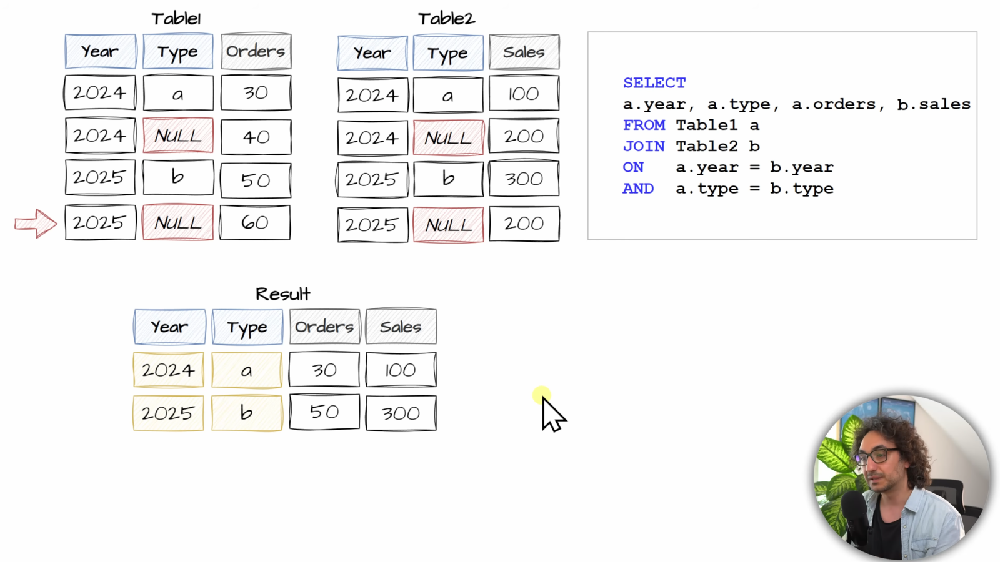

We are going to lose record in the output if have null inside our key. So, it is important to handle NULL inside the key before doing joins. So, we are going to handle the null by replacing it with empty string before doing joins.

**Solution**

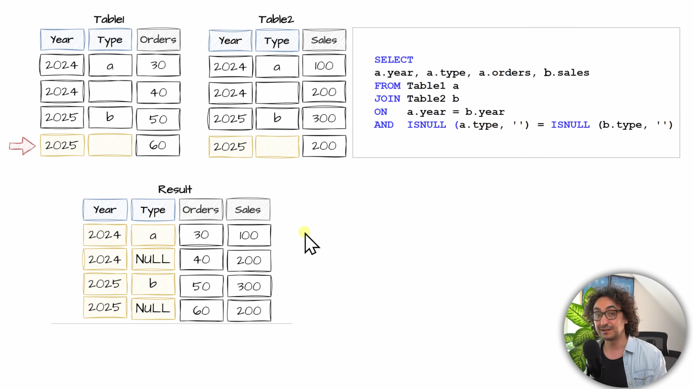

So, to get complete result without losing any records when joining the table we can use ISNULL function to check key.

**Sorting Data**

\- Handle the NULL before sorting the data.

**Example**

```sql
-- Sort the customers from lowest to highest scores with NULL appearing at last.
SELECT
    c.CustomerID ,
    c.Score
FROM Sales.Customers c
ORDER BY CASE WHEN c.Score IS NULL THEN 1 ELSE 0 END, c.score
```

| CustomerID | Score |
| ---------- | ----- |
| 1          | 350   |
| 4          | 500   |
| 3          | 750   |
| 2          | 900   |
| 5          | NULL  |

#### **Null Functions: Summary**

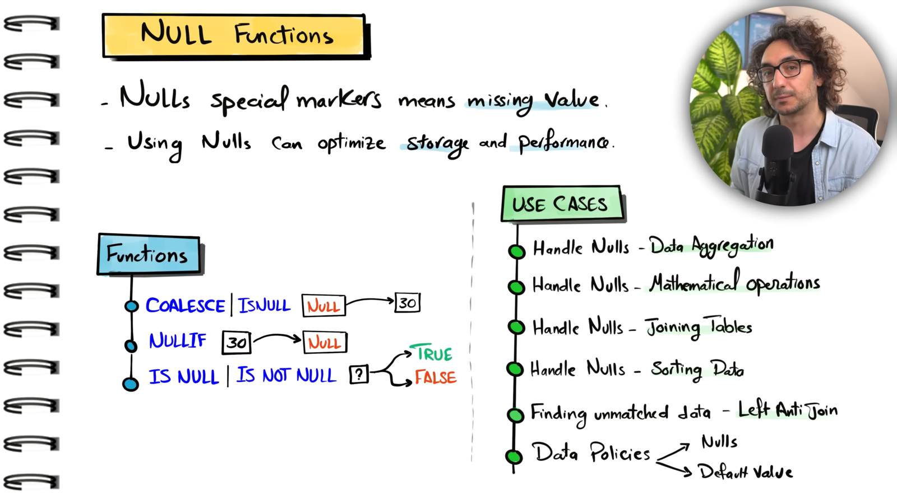
