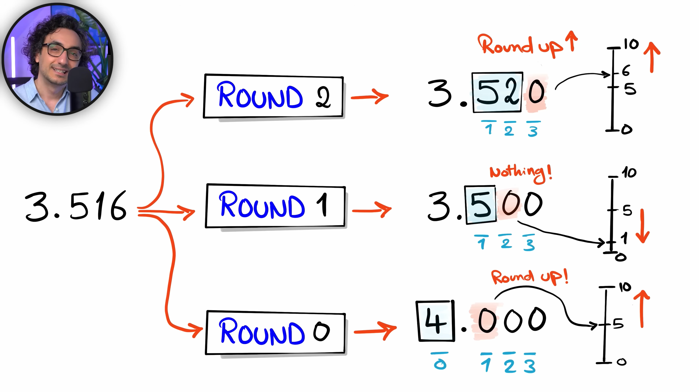

## Number Functions

← Previous: [String Functions](string-functions.md) | [Index](../README.md) | Next → [Date & Time Functions](date-time-functions.md)

#### **ROUND**



**Example**

```sql
SELECT
    3.516,
    ROUND(3.516, 2) AS round_2,
    ROUND(3.516, 1) AS round_1,
    ROUND(3.516, 0) AS round_0
```

#### **ABS**

\- Convert negative number to positive

**Example**

```sql
SELECT
    -10,
    ABS(-10),
    ABS(10)
```
