## Joins

← Previous: [Combining Data](../combining-data/combining-data.md) | [Index](../README.md) | Next → [Set Operators](../set-operators/set-operators.md)

### Why We Join Tables?

1) **Recombining data**
   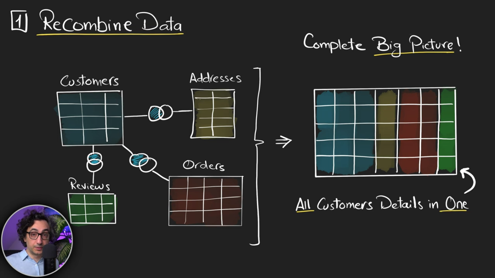

   lets say we have customer data splits in multiple table and then later we want all the data of customer in a result then we can connect all the table together using sql joins which allow us query to combine all the table in one big results.

2) **Data Enrichment**
   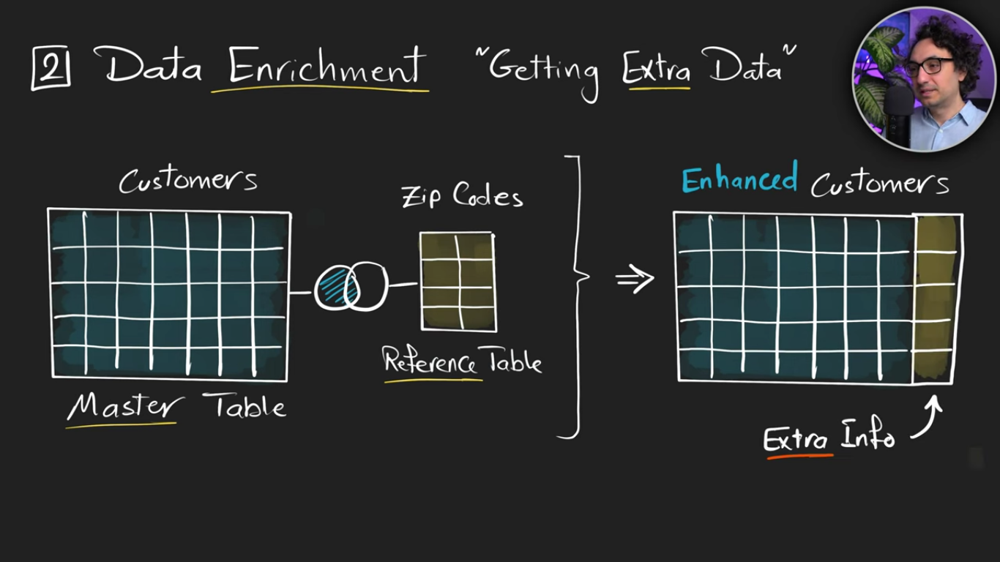

   we can use sql join to get extra info in result. if we have customer table as master table and we want information from another table like zip codes or help from another table which we called reference table or lookup table where we would like to add one extra infromation to master table. now we can join these to table to enhance our result.

3) **Check for Existence (Filtering)**

   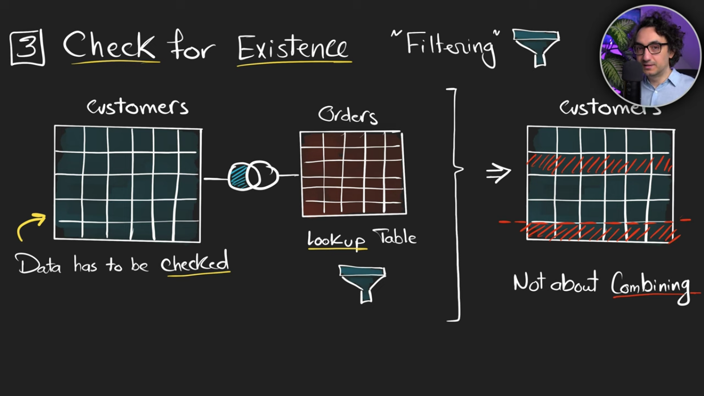

   we don't want to combine data but we just join with another table to check the existence of records. if we have customer and we want to look up or find or filter the custome based on customer has any order or not so we can join the reference table like orders and then filter based on that. in result we will not get any customer which doesn't have any order.

### Join Types

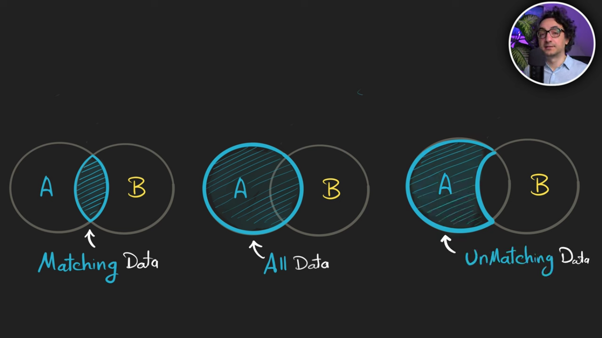

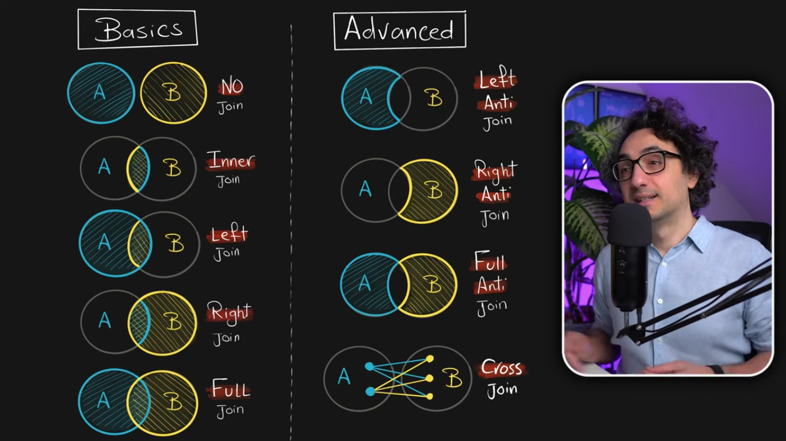

#### Basic Joins

##### No Join

- Returns data from the tables without combining them.

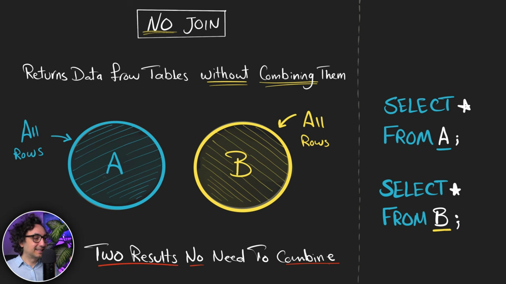

**Example**
```sql
-- Retrieve all data from customers and orders as separate results
SELECT * FROM customers c;

SELECT * FROM orders o;
```
##### Inner Join

- Returns only matching rows from both tables.
- The order of the tables doesn't matter.

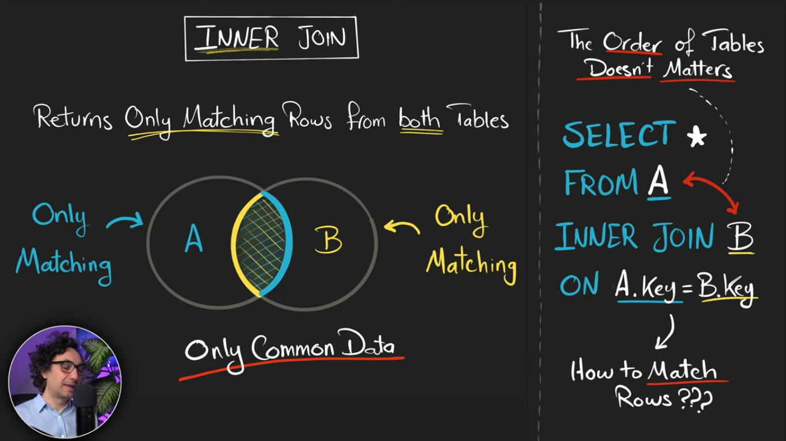

**How Inner Join Gets Executed?**

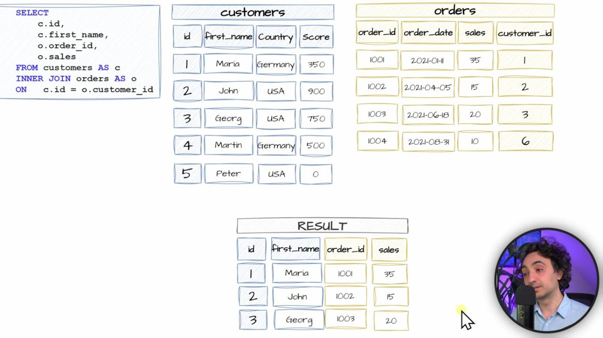

- We can use inner joins to either recombine the data or to filter the data.

**Example**
```sql
-- Get all customers along with their orders, but only for customers who have placed an order
SELECT
    c.id,
    c.first_name,
    o.order_id,
    o.sales
FROM customers AS c
INNER JOIN orders AS o
    ON c.id = o.customer_id;
```

##### Left Join

- Returns all rows from the left table and only matching rows from the right table.

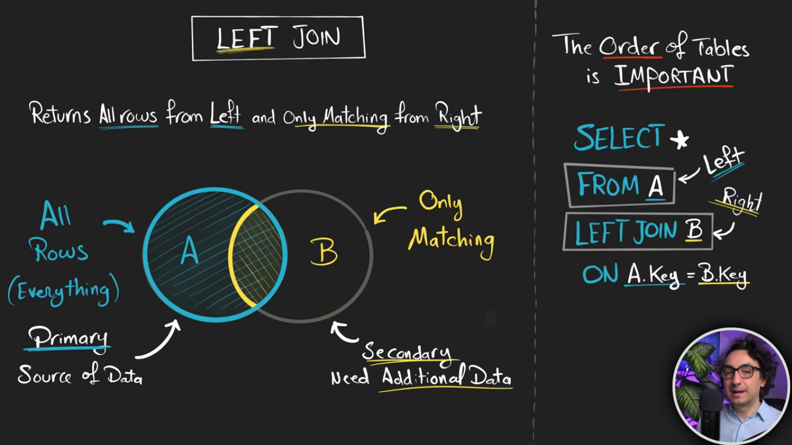

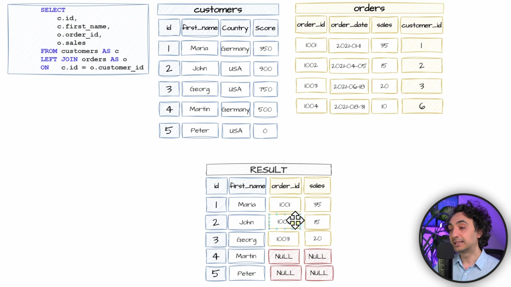

**Example**
```sql
-- Get all customers along with their orders, including those without orders.
SELECT
    c.id,
    c.first_name,
    o.order_id,
    o.sales
FROM customers c
LEFT JOIN orders o
    ON c.id = o.customer_id;
```

##### Right Join

- Returns all rows from the right table and only matching rows from the left table.

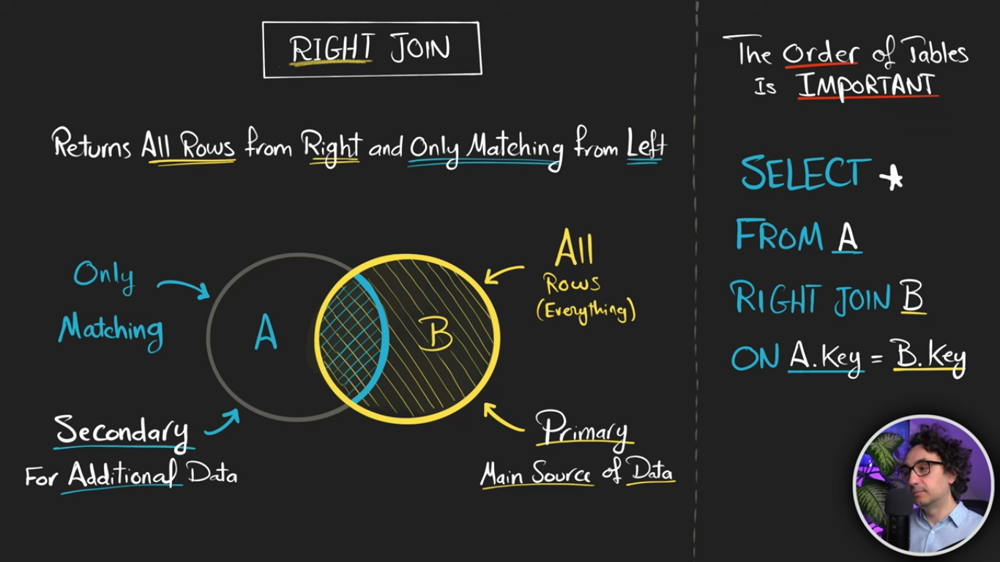

**Example**
```sql
-- Get all customers along with their orders, including orders without matching customers.
SELECT
    c.id,
    c.first_name,
    o.order_id,
    o.sales
FROM customers c
RIGHT JOIN orders o
    ON c.id = o.customer_id;
```

- A right join can also be written as a left join by swapping the table order:

```sql
SELECT
    c.id,
    c.first_name,
    o.order_id,
    o.sales
FROM orders o
LEFT JOIN customers c
    ON o.customer_id = c.id;
```

##### Full Join

- Returns all rows from both tables, matching rows where possible.

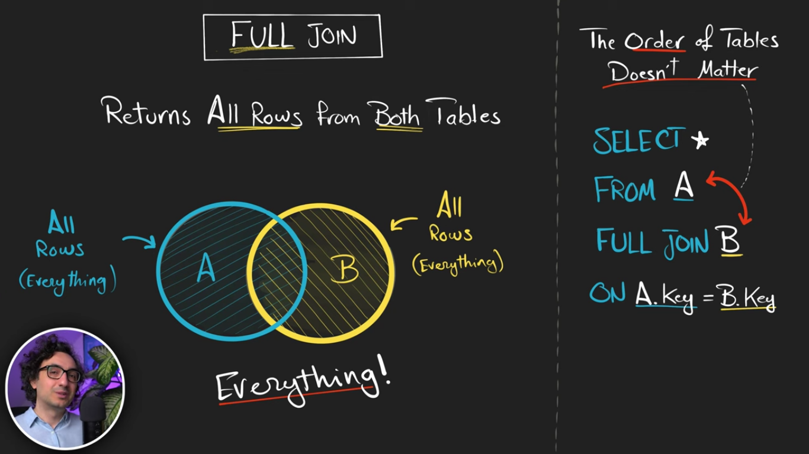

**Example**
```sql
-- Get all customers and all orders, even if there's no match
SELECT
    c.id,
    c.first_name,
    o.order_id,
    o.sales
FROM customers c
FULL JOIN orders o
    ON c.id = o.customer_id;
```

#### Advanced Joins

##### LEFT ANTI JOIN

- Return Row from left that has **NO MATCH** in Right table.

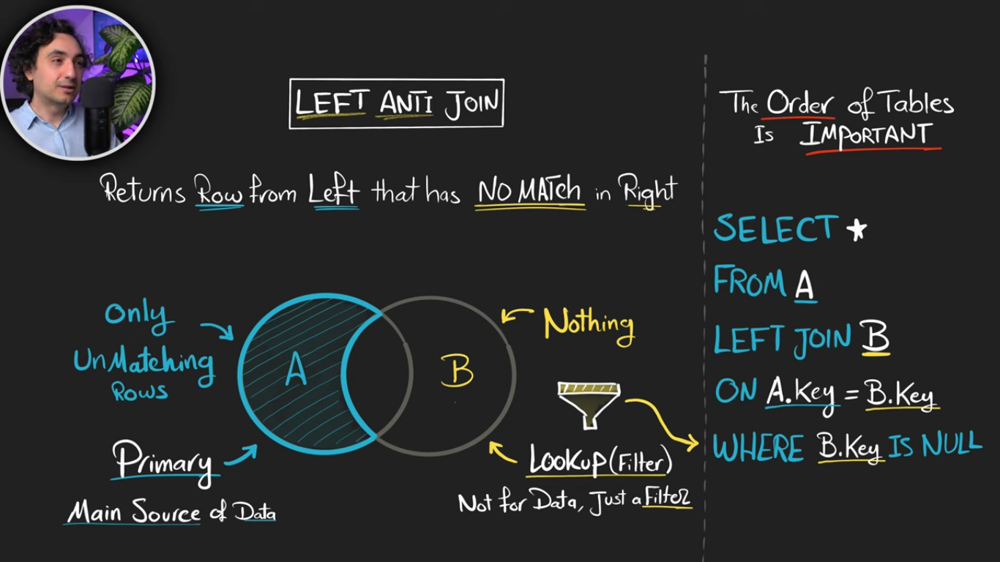

**Example**
```sql
-- Get all customers who haven't placed any order.
SELECT
	c.id ,
	c.first_name ,
	o.order_id ,
	o.sales
FROM customers c
LEFT JOIN orders o
	ON c.id = o.customer_id
WHERE o.customer_id is NULL;
```

##### RIGHT ANTI JOIN

- Return Row from right table that has **NO MATCH** in light table.

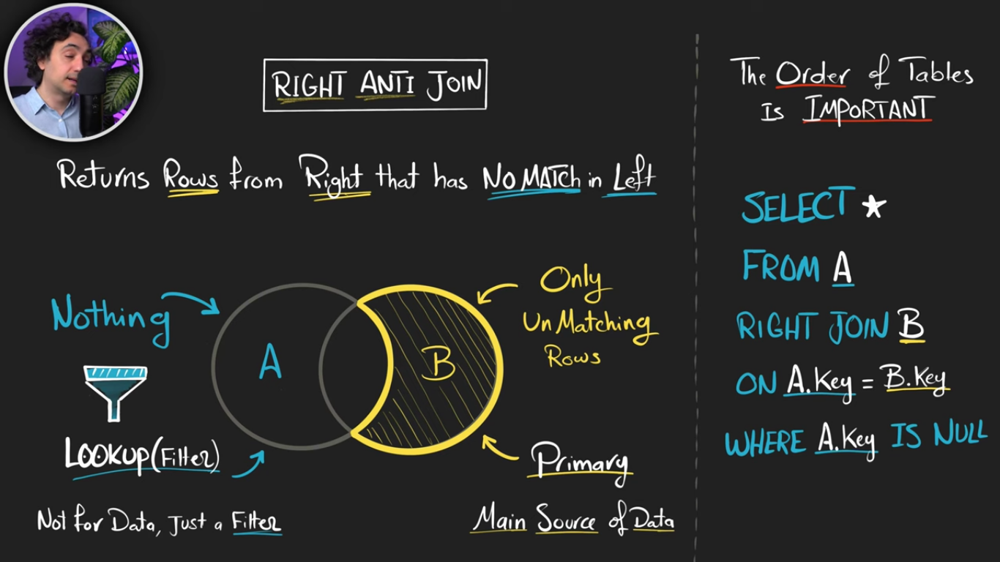

**Example**
```sql
-- Get all orders without matching customers // all orders without valid customers
SELECT 
	c.id ,
	c.first_name ,
	o.order_id ,
	o.sales 
FROM customers c 
RIGHT JOIN orders o 
	ON c.id = o.customer_id
WHERE c.id IS NULL;
```

- A right join can also be written as a left join by swapping the table order:

```sql
SELECT 
	c.id ,
	c.first_name ,
	o.order_id ,
	o.sales 
FROM orders o 
LEFT JOIN customers c 
	ON o.customer_id = c.id 
WHERE c.id IS NULL;
```

##### FULL ANTI JOIN

- Return only rows that don't match in either tables. it is opposite of inner join where we get only matching data in full anti join we only get unmatching data.

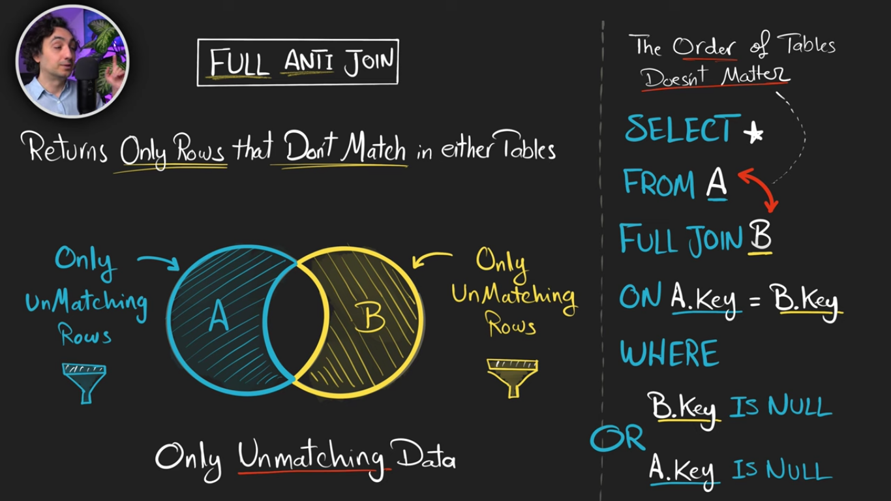

**Example**
```sql
-- find customers without orders and orders without customers
SELECT 
	c.id,
	c.first_name ,
	o.order_id ,
	o.sales 
FROM customers c 
FULL JOIN orders o 
	ON c.id = o.customer_id
WHERE o.customer_id IS NULL OR c.id IS NULL;
```

##### CROSS JOIN

- combines every row from left with every row from right.

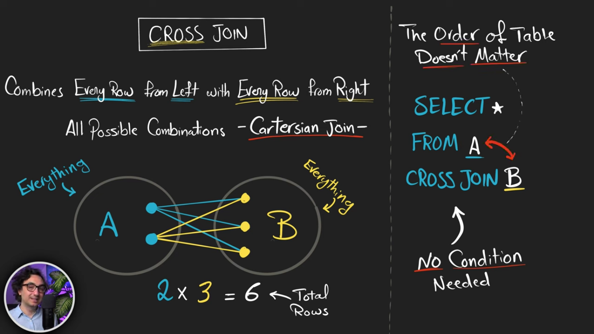

**Example**
```sql
-- Generate all possible combinations of customers and orders
SELECT 
	*
FROM customers c 
CROSS JOIN orders o;
```

\- Output of Cross JOIN
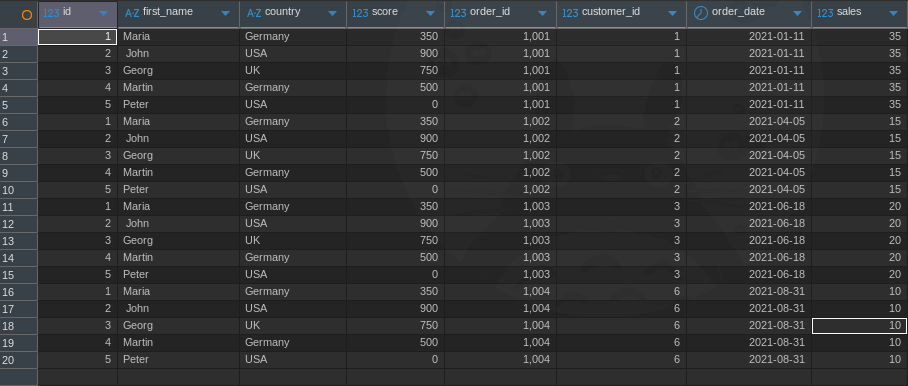

#### How To Choose Between Join Types?

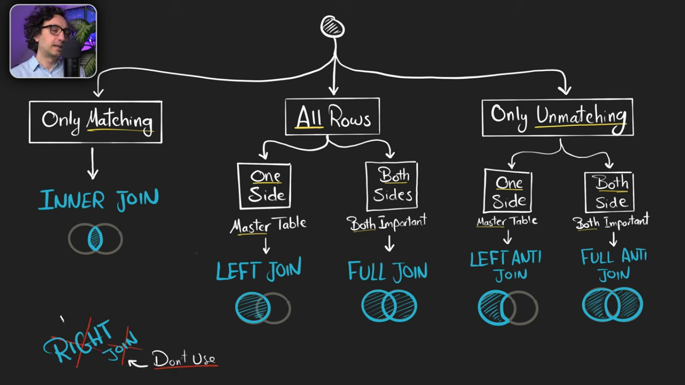

#### Multi-Table Join

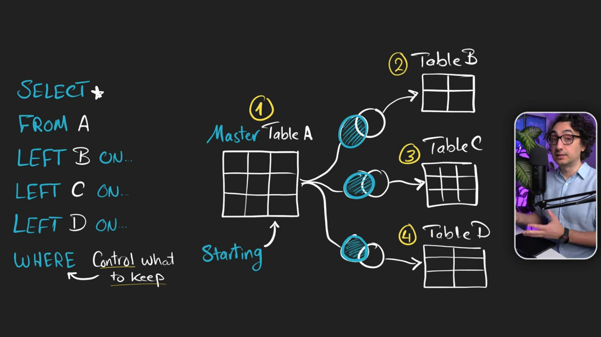

when doing analysis, the author starts with main table and if he need extra information he then left join other table one by one and see the results and at last use where clause to control what to keep. he could have use inner join but use left join with where clause because he get more flexibility on whether he want matching, unmatching data.

\- **Visualizing the flow**
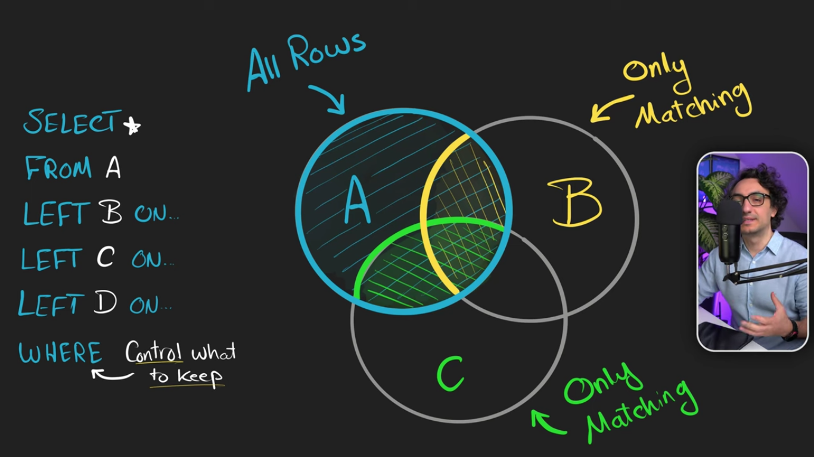
We get all data from A and then only matching data from B. then we left join C and we get only matching data from C. and how many other table we join we only get matching data.

**Example**
```sql
-- using salesDb, retrieve a list of all orders, along with the related customers, product and employee details. For each order, display: orderId, customer's name, product name, sales, product price, salesperson name
SELECT 
	o.OrderID ,
	c.FirstName AS CustomerFirstName,
	c.LastName AS CustomerLastName,
	p.Product AS ProductName,
	o.Sales ,
	p.Price ,
	e.FirstName AS EmployeeFirstName,
	e.LastName As EmpolyeeLastName
FROM Sales.Orders o
LEFT JOIN Sales.Customers c 
	ON o.CustomerID = c.CustomerID 
LEFT JOIN Sales.Products p 
	ON o.ProductID = p.ProductID 
LEFT JOIN Sales.Employees e 
	ON o.SalesPersonID = e.EmployeeID ;
```
