## Set Operators

← Previous: [Joins](../joins/joins.md) | [Index](../README.md) | Next → [SQL Functions](../functions/Sql%20functions.md)

### Syntax of Set Operator

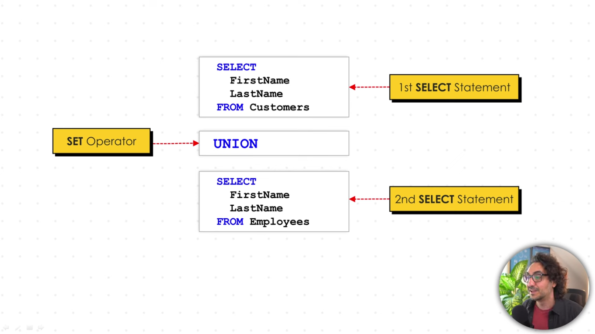

### Rules of Set Operator

1) SQL Clauses
    - SET Operators can be used almost in all clauses WHERE | JOIN | GROUP BY | HAVING
    - ORDER BY is allowed only once at the end of the query

    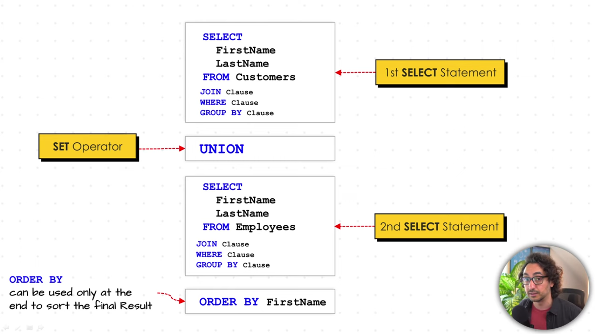

2) Number of columns
    - The number of columns in each query must be the same.
3)  Data Types
    - Data types of columns in each query must be compatible
4) Order of Columns
    - The order of the columns in each query must be the same
5) Column Aliases
    - The column names in the result set are determined by the column name specified in the first query.
6) Correct Columns
    - Even if all rules are met and SQL shows no errors, the result may be incorrect.
    - Incorrect columns selections leads to inaccurate results.

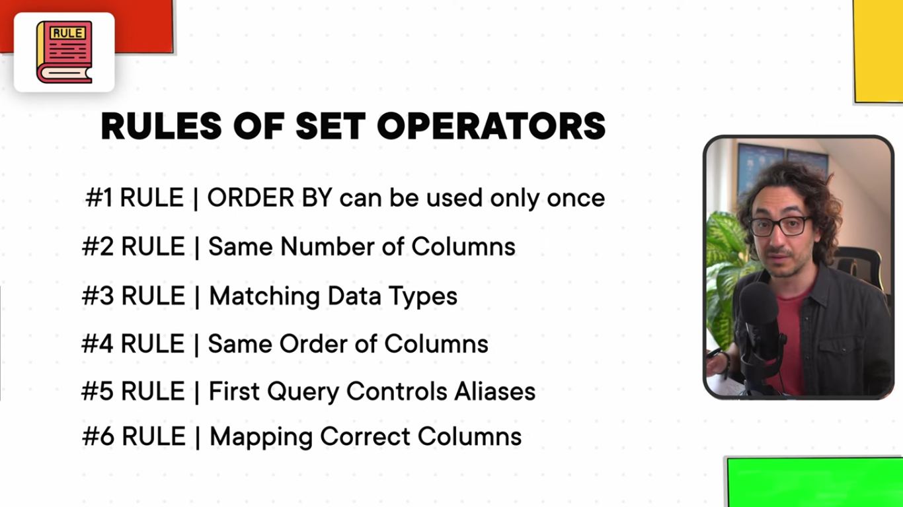

### Union Types

#### UNION

\- Returns all distinct rows from both queries.
\- Removes duplicate rows from the result

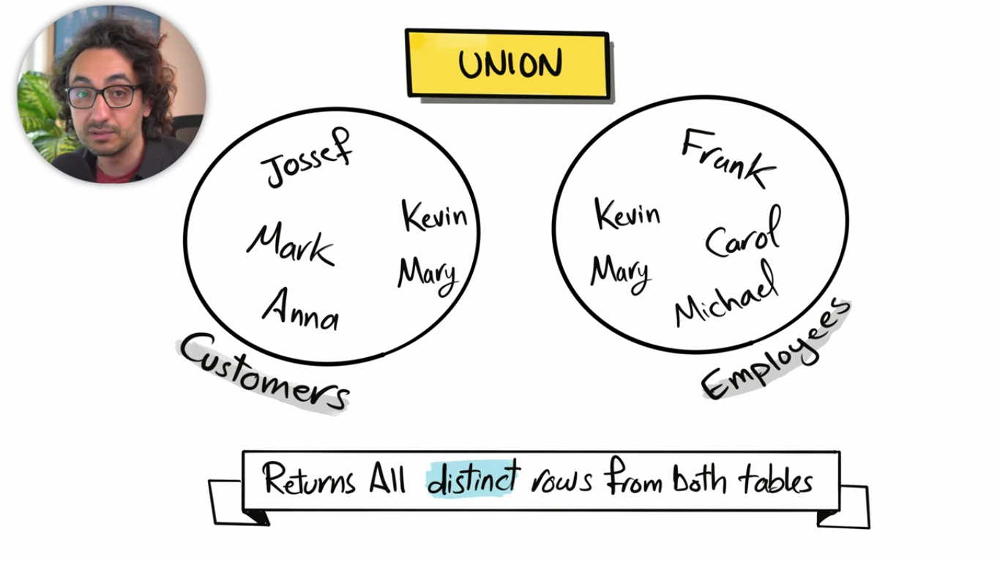

Since we have mary and kevin in both set so union will return only one in the result.

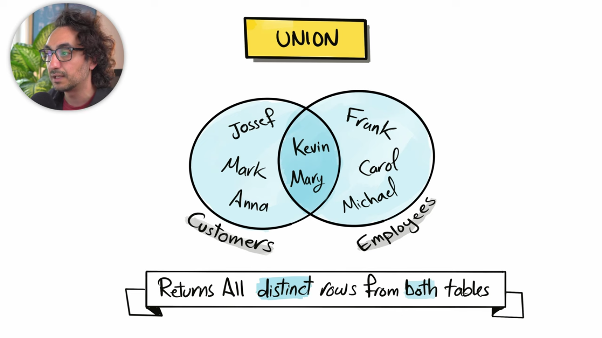

**Example**

```sql
-- Combine the data from employess and customer into one table
SELECT
    e.FirstName,
    e.LastName
FROM Sales.Employees e
UNION
SELECT
    c.FirstName,
    c.LastName
FROM Sales.Customers c
```

| FirstName | LastName |
| --------- | -------- |
| Anna      | Adams    |
| Carol     | Baker    |
| Frank     | Lee      |
| Jossef    | Goldberg |
| Kevin     | Brown    |
| Mark      | Schwarz  |
| Mary      | NULL     |
| Michael   | Ray      |

The order of queries in a UNION operation does not affect the result.

**How SQL execute the UNION**

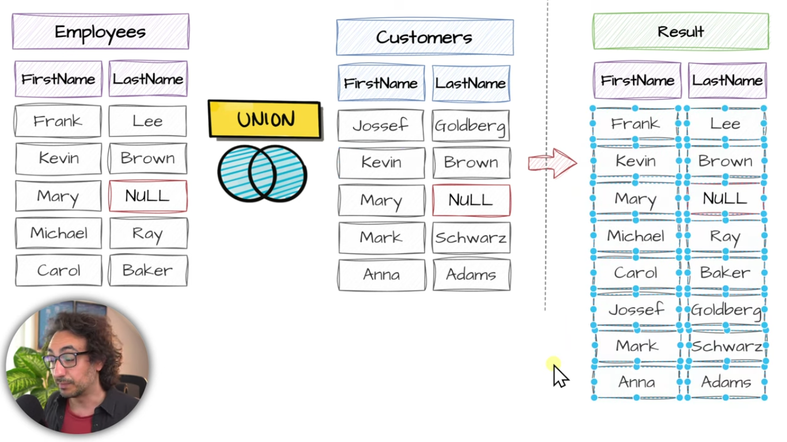

#### UNION ALL

\- Return all rows from both queries, including duplicates
\- Only set operator that doesn't remove duplicate and return result as it is.

**UNION ALL VS UNION**

- UNION ALL is generally faster than UNION because it doesn't have to extra step of removing duplicate. So, If you're confident there's no duplicate, use UNION ALL to get better performance.
- Use UNION ALL to find duplicates and quality issues.

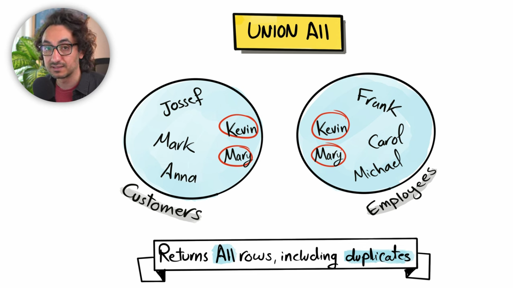

Union all is gonna return all from customers and all from employees. and kevin and mary is twice in the output.

**Example**

```sql
-- Combine the data from employess and customer into one table, including duplicates.
SELECT
    e.FirstName ,
    e.LastName
FROM Sales.Employees e
UNION ALL
SELECT
    c.FirstName ,
    c.LastName
FROM Sales.Customers c
```

| FirstName | LastName |
| --------- | -------- |
| Frank     | Lee      |
| Kevin     | Brown    |
| Mary      | NULL     |
| Michael   | Ray      |
| Carol     | Baker    |
| Jossef    | Goldberg |
| Kevin     | Brown    |
| Mary      | NULL     |
| Mark      | Schwarz  |
| Anna      | Adams    |

**How SQL execute the UNION ALL**

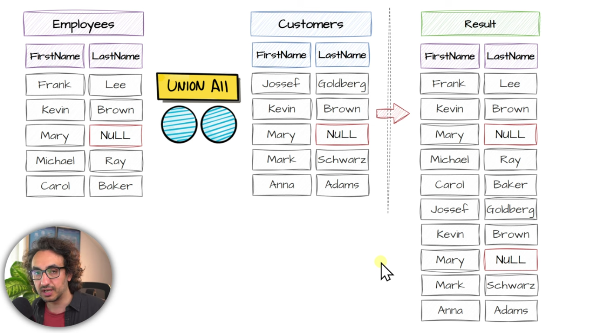

#### EXCEPT

\- Return all distinct rows from the first query that are not found in the second query
\- It is only one where the order of the queries affect the final result.

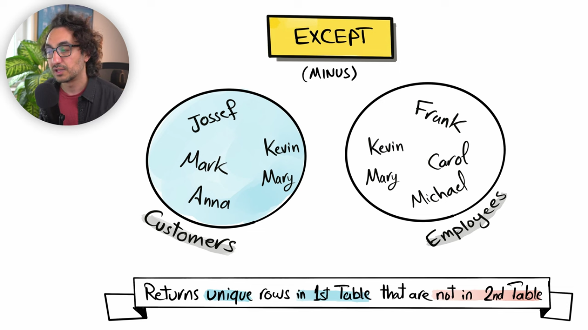

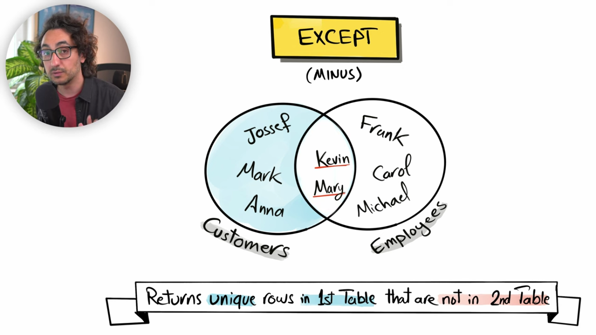

We get Jossef, mark and anna in the result set because they are not in employee set. and kevin and mary are not included in the result set because they are not unique and also member of second set employee. So, we get only three customer as a result.

**Example**

```sql
-- find employess who are not customer at the same time
SELECT
    e.FirstName ,
    e.LastName
FROM Sales.Employees e
EXCEPT
SELECT
    c.FirstName ,
    c.LastName
FROM Sales.Customers c
```

| FirstName | LastName |
| --------- | -------- |
| Carol     | Baker    |
| Frank     | Lee      |
| Michael   | Ray      |

**How SQL execute the EXCEPT**

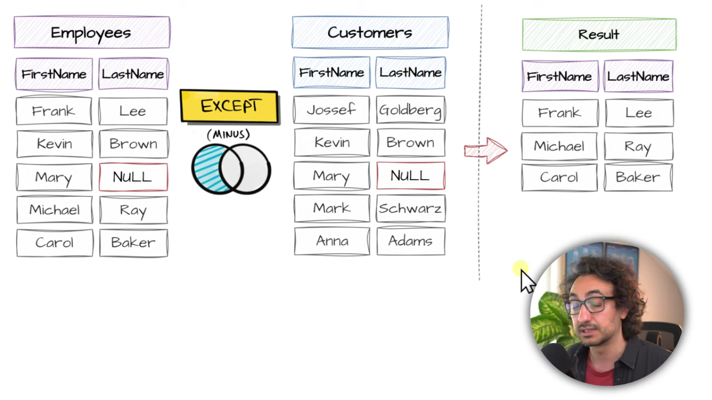

It doesn't put any data from second query or set which is customer here. it only use for lookup.

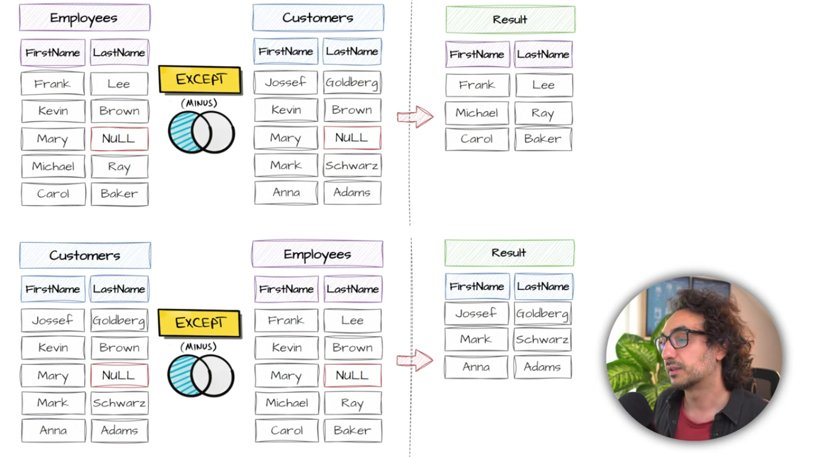

The order of query is important because we get different result if order is different.

#### INTERSECT

\- Returns only the rows that are common in both queries.

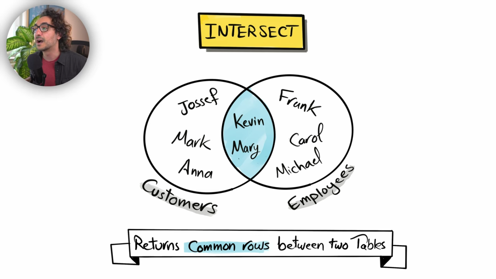

**Example**

```sql
-- find employees who are also customers
SELECT
    e.FirstName ,
    e.LastName
FROM Sales.Employees e
INTERSECT
SELECT
    c.FirstName,
    c.LastName
FROM Sales.Customers c
```

| FirstName | LastName |
| --------- | -------- |
| Kevin     | Brown    |
| Mary      | NULL     |

**How SQL execute the INTERSECT**

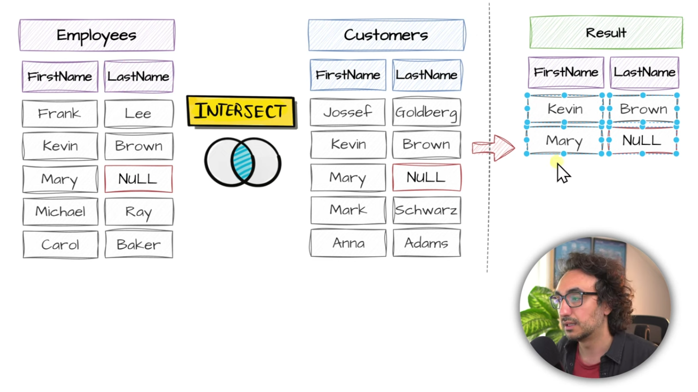

### Union Use Cases

#### **Combine Information**

\- Combine similar information before analyzing the data

**Example**


If we want to combine information to generate report. we can do this way but we have too many single sql query and we may encounter inconsistent data in the report. Instead we can use set operators to combine the all these table data into one single table.

**Example with set operators**

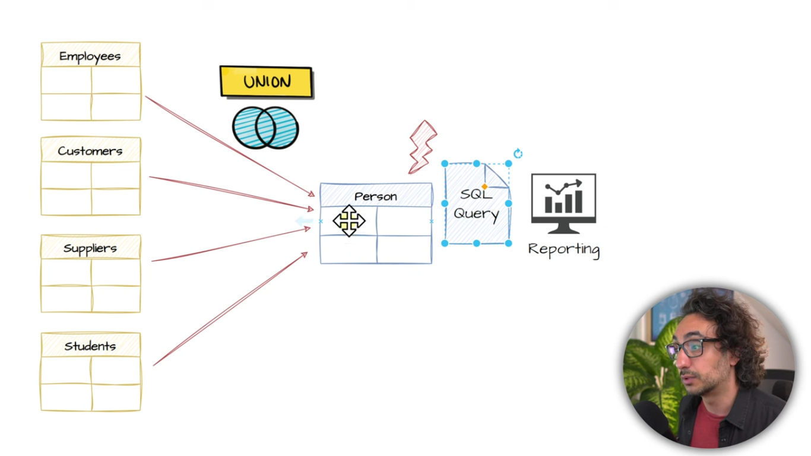

Here we have one single big table and one sql query.

**Example 2 with set operators**

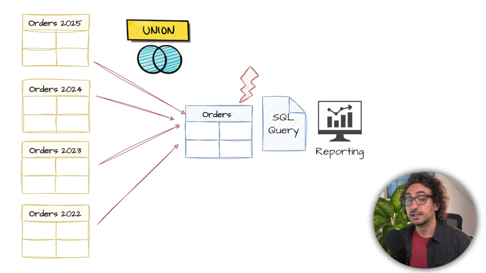

**Example**

```sql
-- Orders are stored in separate table (Orders and Order Archive). Combine all orders into one report without duplicates.
SELECT
    'Orders' AS SourceTable,
    OrderID,
    ProductID,
    CustomerID,
    SalesPersonID,
    OrderDate,
    ShipDate,
    OrderStatus,
    ShipAddress,
    BillAddress,
    Quantity,
    Sales,
    CreationTime
FROM Sales.Orders
UNION
SELECT
    'OrderArchive' AS SourceTable,
    OrderID,
    ProductID,
    CustomerID,
    SalesPersonID,
    OrderDate,
    ShipDate,
    OrderStatus,
    ShipAddress,
    BillAddress,
    Quantity,
    Sales,
    CreationTime
FROM Sales.OrdersArchive oa
ORDER BY OrderID;
```

| SourceTable  | OrderID | ProductID | CustomerID | SalesPersonID | OrderDate  | ShipDate   | OrderStatus | ShipAddress        | BillAddress    | Quantity | Sales | CreationTime                |
| ------------ | ------- | --------- | ---------- | ------------- | ---------- | ---------- | ----------- | ------------------ | -------------- | -------- | ----- | --------------------------- |
| OrderArchive | 1       | 101       | 2          | 3             | 2024-04-01 | 2024-04-05 | Shipped     | 123 Main St        | 456 Billing St | 1        | 10    | 2024-04-01 12:34:56.0000000 |
| Orders       | 1       | 101       | 2          | 3             | 2025-01-01 | 2025-01-05 | Delivered   | 9833 Mt. Dias Blv. | 1226 Shoe St.  | 1        | 10    | 2025-01-01 12:34:56.0000000 |
| OrderArchive | 2       | 102       | 3          | 3             | 2024-04-05 | 2024-04-10 | Shipped     | 456 Elm St         | 789 Billing St | 1        | 15    | 2024-04-05 23:22:04.0000000 |
| Orders       | 2       | 102       | 3          | 3             | 2025-01-05 | 2025-01-10 | Shipped     | 250 Race Court     | NULL           | 1        | 15    | 2025-01-05 23:22:04.0000000 |
| OrderArchive | 3       | 101       | 1          | 4             | 2024-04-10 | 2024-04-25 | Shipped     | 789 Maple St       | 789 Maple St   | 2        | 20    | 2024-04-10 18:24:08.0000000 |
| Orders       | 3       | 101       | 1          | 5             | 2025-01-10 | 2025-01-25 | Delivered   | 8157 W. Book       | 8157 W. Book   | 2        | 20    | 2025-01-10 18:24:08.0000000 |
| OrderArchive | 4       | 105       | 1          | 3             | 2024-04-20 | 2024-04-25 | Delivered   | 987 Victory Lane   |                | 2        | 60    | 2024-04-20 14:50:33.0000000 |
| OrderArchive | 4       | 105       | 1          | 3             | 2024-04-20 | 2024-04-25 | Shipped     | 987 Victory Lane   |                | 2        | 60    | 2024-04-20 05:50:33.0000000 |
| Orders       | 4       | 105       | 1          | 3             | 2025-01-20 | 2025-01-25 | Shipped     | 5724 Victory Lane  |                | 2        | 60    | 2025-01-20 05:50:33.0000000 |
| OrderArchive | 5       | 104       | 2          | 5             | 2024-05-01 | 2024-05-05 | Shipped     | 345 Oak St         | 678 Pine St    | 1        | 25    | 2024-05-01 14:02:41.0000000 |
| Orders       | 5       | 104       | 2          | 5             | 2025-02-01 | 2025-02-05 | Delivered   | NULL               | NULL           | 1        | 25    | 2025-02-01 14:02:41.0000000 |
| OrderArchive | 6       | 101       | 3          | 5             | 2024-05-05 | 2024-05-10 | Delivered   | 543 Belmont Rd.    | 3768 Door Way  | 2        | 50    | 2024-05-12 20:36:55.0000000 |
| OrderArchive | 6       | 104       | 3          | 5             | 2024-05-05 | 2024-05-10 | Delivered   | 543 Belmont Rd.    | NULL           | 2        | 50    | 2024-05-06 15:34:57.0000000 |
| OrderArchive | 6       | 104       | 3          | 5             | 2024-05-05 | 2024-05-10 | Delivered   | 543 Belmont Rd.    | 3768 Door Way  | 2        | 50    | 2024-05-07 13:22:05.0000000 |
| Orders       | 6       | 104       | 3          | 5             | 2025-02-05 | 2025-02-10 | Delivered   | 1792 Belmont Rd.   | NULL           | 2        | 50    | 2025-02-06 15:34:57.0000000 |
| OrderArchive | 7       | 102       | 3          | 5             | 2024-06-15 | 2024-06-20 | Shipped     | 111 Main St        | 222 Billing St | 0        | 60    | 2024-06-16 23:25:15.0000000 |
| Orders       | 7       | 102       | 1          | 1             | 2025-02-15 | 2025-02-27 | Delivered   | 136 Balboa Court   |                | 2        | 30    | 2025-02-16 06:22:01.0000000 |
| Orders       | 8       | 101       | 4          | 3             | 2025-02-18 | 2025-02-27 | Shipped     | 2947 Vine Lane     | 4311 Clay Rd   | 3        | 90    | 2025-02-18 10:45:22.0000000 |
| Orders       | 9       | 101       | 2          | 3             | 2025-03-10 | 2025-03-15 | Shipped     | 3768 Door Way      |                | 2        | 20    | 2025-03-10 12:59:04.0000000 |
| Orders       | 10      | 102       | 3          | 5             | 2025-03-15 | 2025-03-20 | Shipped     | NULL               | NULL           | 0        | 60    | 2025-03-16 23:25:15.0000000 |

### Except Use Case

#### **Delta Detection**

\- Identify the difference or change (delta) between two batches of data.

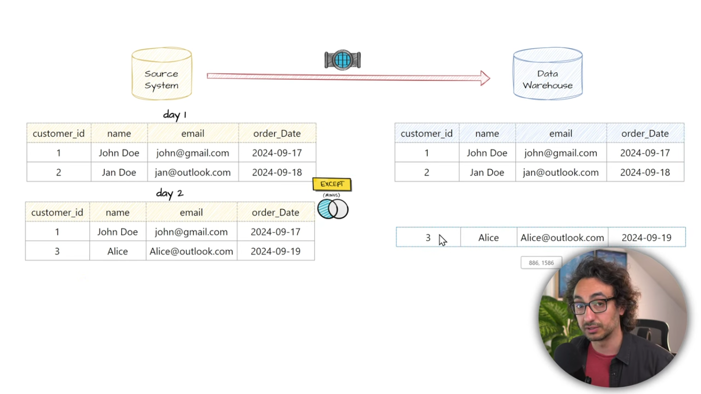

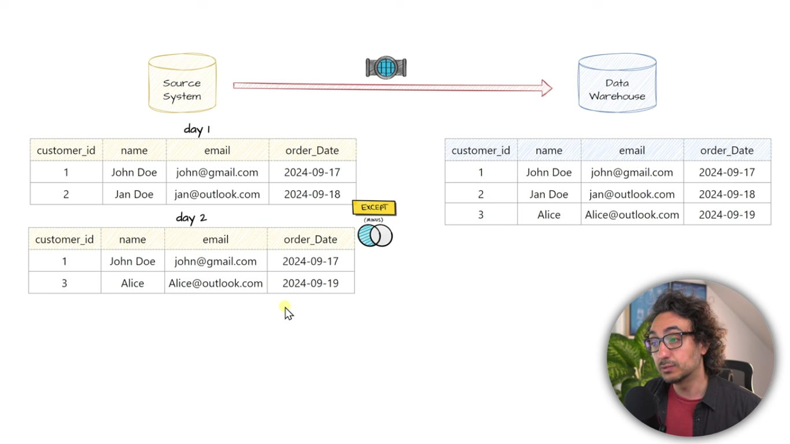

#### Data Completeness Check

\- EXCEPT operator can be used to compare tables to detect discrepancies between databases.

**Example**

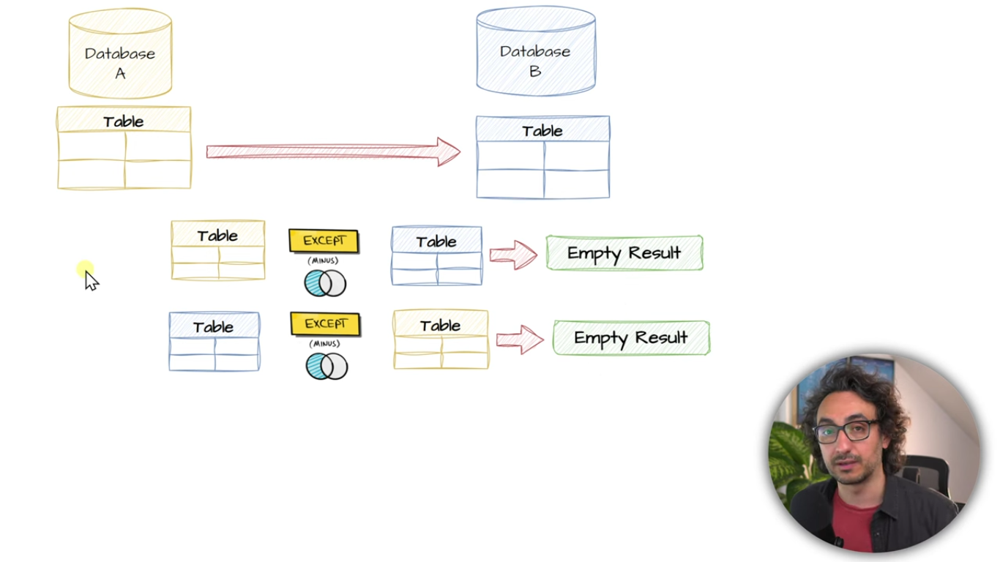

let's say we are doing data migration between two database. where we want to migrate table from database A to database B. now first we load the table from db A to db B , now to check if all the records move from table A to Table B we can use EXCEPT set operators to data completeness test.
\- first test is we can use except to check if there is any record still in table of database A that is not in table of database B. the result should be empty which means all the records in database A table exits in table of database B.
\- another test is we can use expect to find any row that is in table of database B that is not in table of database A because both table in database A and B must be identical.
So, if both are empty then we can be sure that these both table are identical and we are not missing anything. Therefore, we can use EXCEPT set operator to prove quality of data migration and to do data completeness test.

#### Summary of Set Operators

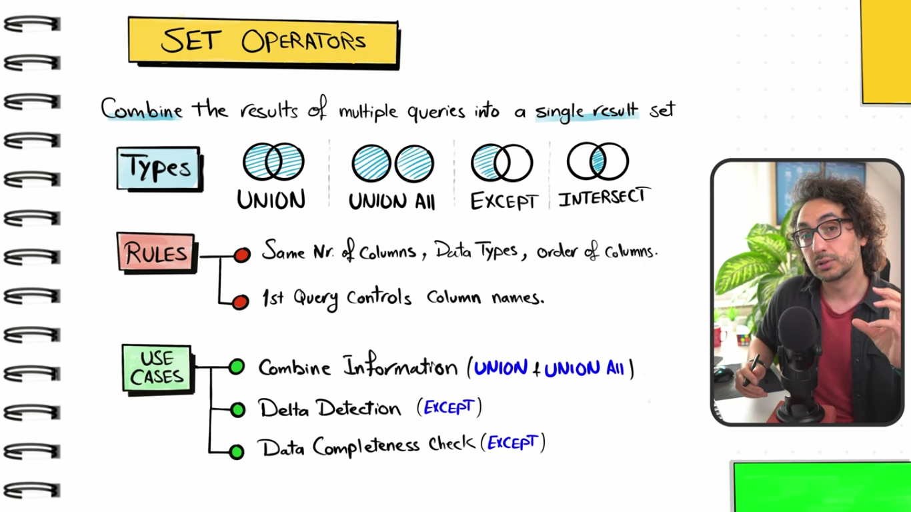
