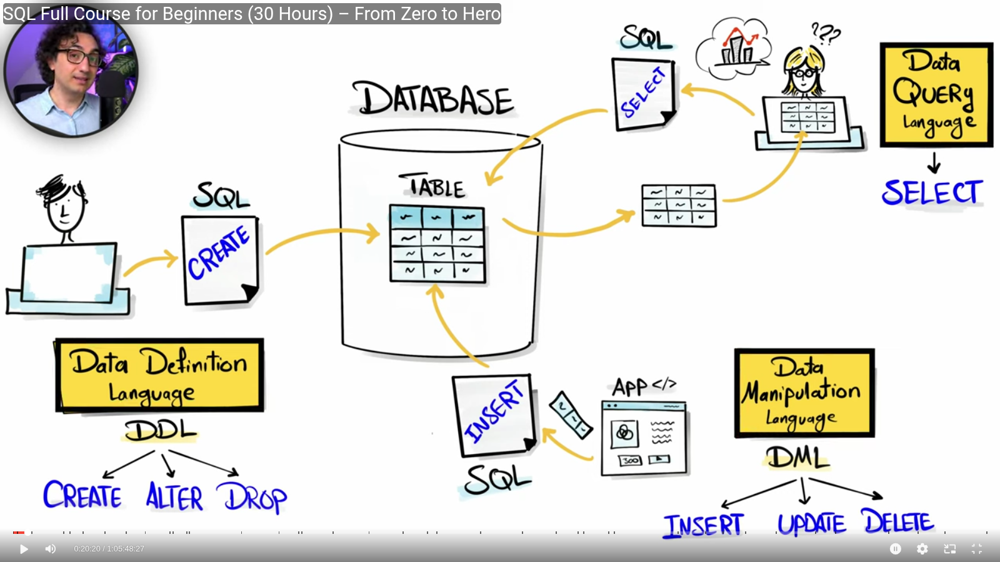

## SQL Commands

← Previous: [SQL Fundamentals](../sql-fundamentals/sql-fundamentals.md) | [Index](../README.md) | Next → [Clauses](../clauses/clauses.md)

### Command Categories

- **Data Definition Language (DDL):** command used to define structure (we have CREATE, ALTER, and DROP).
- **Data Manipulation Language (DML):** command used to manipulate the data that is stored in the database (INSERT, DELETE, UPDATE).
- **Data Query Language (DQL):** now we have data — to analyze the stored data we use this command, and we have the SELECT command.

### Data Definition Language (DDL)

- Define the structure of your data.
- These commands will never return data; they change the structure of the database.
- We have CREATE, ALTER, and DROP statements.

#### DROP vs TRUNCATE

Both are DDL commands and both remove data, but they remove different amounts of the table:

|                               | TRUNCATE                                     | DROP                           |
| ----------------------------- | -------------------------------------------- | ------------------------------ |
| Removes                       | All rows                                     | All rows + the table structure |
| Table after                   | Still exists (empty)                         | No longer exists               |
| Columns, indexes, constraints | Kept                                         | Removed with the table         |
| `WHERE` clause                | Not allowed                                  | Not applicable                 |
| Identity column               | Resets                                       | Deleted with the table         |
| Use when                      | We want to empty the table but keep using it | We no longer need the table    |

**TRUNCATE:**

- Removes all rows at once but keeps the table.
- The columns, indexes, constraints, and table definition stay.
- Resets the identity column.
- We can still query and insert into the table afterwards.
- Cannot be used when another table has a foreign key pointing to it (unless the constraint is dropped).

**DROP:**

- Removes the table completely — both the data and the table structure.
- After `DROP`, the table no longer exists, so we cannot query or insert into it.
- To use it again, we have to create the table again.
- `DROP` also works on other objects like databases, views, and schemas.

**When to use:**

- Use `TRUNCATE` when we want to clear the table but keep it for later.
- Use `DROP` when we are done with the table and want to remove it completely.

### Data Manipulation Language (DML)

- Modify (manipulate) your data.
- We have INSERT, UPDATE, and DELETE.

**INSERT:**

- We can insert data manually, where we type the whole command: `INSERT INTO ...`
- Another way: insert with a SELECT statement.
- To insert data into a table, we must have matching data type, constraints, and column count.

**UPDATE:**

- We can use an UPDATE statement to update the value of a single column or multiple columns.

**DELETE:**

- To remove data in a table we have DELETE and TRUNCATE.
