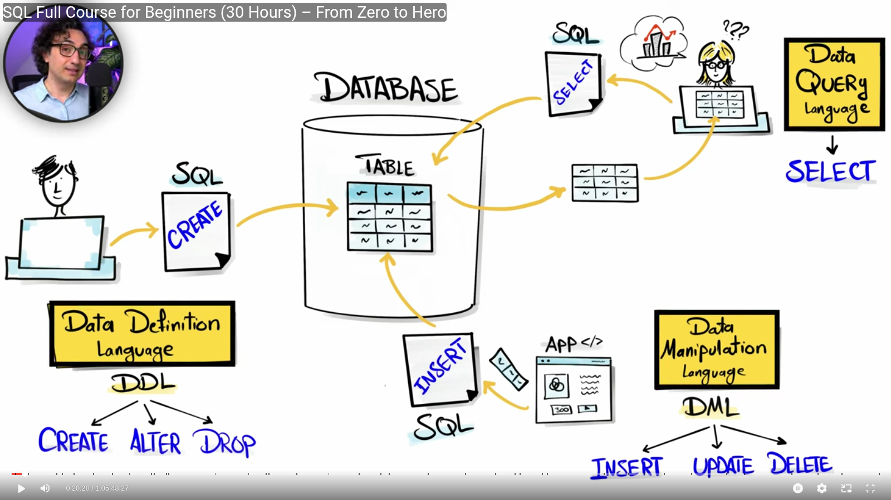

# SQL Commands

← Previous: [SQL Fundamentals](../sql-fundamentals/sql-fundamentals.md) | [Index](../README.md) | Next → [Clauses](../clauses/clauses.md)

## Command Categories
- **Data Definition Language (DDL):** command used to define structure (we have CREATE, ALTER, and DROP).
- **Data Manipulation Language (DML):** command used to manipulate the data that is stored in the database (INSERT, DELETE, UPDATE).
- **Data Query Language (DQL):** now we have data — to analyze the stored data we use this command, and we have the SELECT command.

## Data Definition Language (DDL)
- Define the structure of your data.
- These commands will never return data; they change the structure of the database.
- We have CREATE, ALTER, and DROP statements.

## Data Manipulation Language (DML)
- Modify (manipulate) your data.
- We have INSERT, UPDATE, and DELETE.

**INSERT:**
- We can insert data manually, where we type the whole command: `INSERT INTO ...`
- Another way: insert with a SELECT statement.
- To insert data into a table, we must have matching data type, constraints, and column count.

**UPDATE:**
- We can use an UPDATE statement to update the value of a single column or multiple columns.

**DELETE:**
- To remove data in a table we have DELETE and TRUNCATE.
