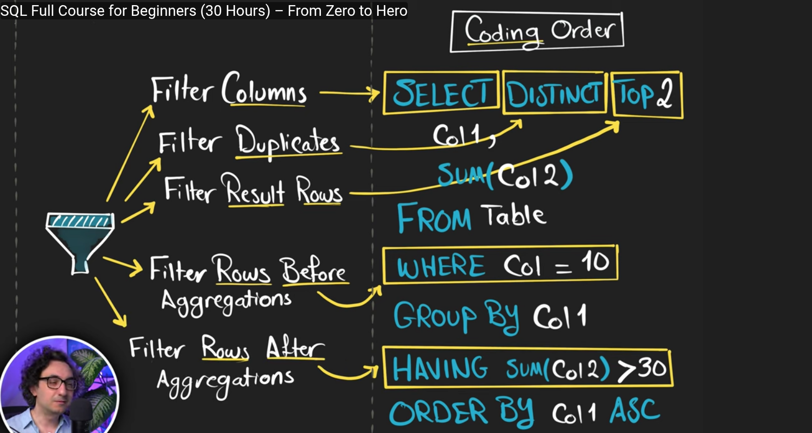
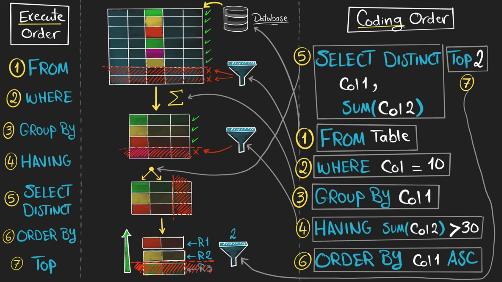
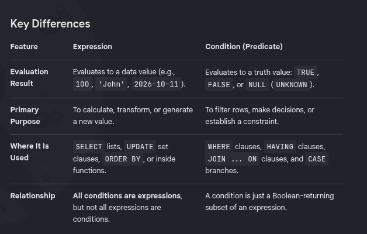

# Week 1 — Database Engineering Notes

## Database?
A database is like a container — it is a kind of organized collection of data.

**Why database?**
- Organizes data in such a way that it is easier to access, manage, and search. This process is fast and efficient.
- Can handle a large amount of data.
- More secure to store data; controls who can access what.

## Why DBMS?
- Multiple users interact with the database at the same time, so we need some kind of software to manage the requests coming to the database (because the database is just a container that only stores data).
- DBMS handles who can execute a query against the database, which query to run, and how to process the request.
- So, DBMS is the software that manages the database.

## Types of Database
- **Relational Database**
- **Key-Value Pair Database** (Redis, Amazon DB)
- **Column Based Database** — main purpose is to search for data (Apache Cassandra)
- **Graph** (Neo4j)
- **Document** (MongoDB)

## Database Structure
- We have a **server**, and in the server we can have multiple **databases**. Inside a database we have **schemas** (logical containers used to organize the tables in the database), and inside a schema we have multiple **tables** which are made up of rows and columns.

	

## SQL Fundamentals

### Quick Overview
- What is a **query**? → request information from the database.
- What is a **statement**? → complete instruction.
- What is a **clause**? → a logical section of a statement (see below).

### SQL Statement
- Definition: An SQL statement is a complete instruction written in SQL that tells a database to perform an operation.
- A statement can retrieve data, insert records, update existing records, delete records, or modify the database structure.

**Examples:**
```sql
    -- Retrieve data
    SELECT * FROM users;

    -- Insert a record
    INSERT INTO users (name, age)
    VALUES ('Ram', 20);

    -- Update a record
    UPDATE users
    SET age = 21
    WHERE name = 'Ram';

    -- Create a table
    CREATE TABLE products (
        id INT,
        name VARCHAR(100)
    );
```
Each example is a complete SQL statement.

**Common categories of SQL statements:**
- **DQL (Data Query Language):** Retrieves data, primarily using `SELECT`.
- **DML (Data Manipulation Language):** Modifies data using commands such as `INSERT`, `UPDATE`, and `DELETE`.
- **DDL (Data Definition Language):** Defines or modifies database structures using commands such as `CREATE`, `ALTER`, and `DROP`.
- **DCL (Data Control Language):** Manages database permissions.
- **TCL (Transaction Control Language):** Manages transactions using commands such as `COMMIT` and `ROLLBACK`.

### SQL Query
- Definition: A query is generally a request to retrieve or examine information stored in a database. In everyday development, the term is also frequently used more broadly to refer to SQL instructions in general.

**Example:**
```sql
    SELECT name, age
    FROM users
    WHERE age >= 18;
```
This query requests the names and ages of users who are at least 18 years old.

**Query vs Statement:**
- The terms *query* and *statement* are often used interchangeably, but their meanings are not always identical.
  - A **statement** is a complete SQL instruction.
  - A **query**, in its narrower sense, requests information from a database.
  - For example, `SELECT` is typically used for querying data, while `INSERT` is a statement that adds data.

### SQL Clause
- Definition: A clause is a logical section of an SQL statement that performs a specific role in the instruction.

Consider this query:
```sql
    SELECT name, age
    FROM users
    WHERE age >= 18
    ORDER BY name;
```

It contains the following clauses:

| Clause           | Purpose                            |
| ---------------- | ---------------------------------- |
| SELECT name, age | Specifies which columns to return. |
| FROM users       | Specifies the source table.        |
| WHERE age >= 18  | Filters rows based on a condition. |
| ORDER BY name    | Sorts the results by name.         |
**Other commonly used clauses:**
- **GROUP BY** — groups rows that share values.
- **HAVING** — filters groups based on a condition.
- **LIMIT** — restricts the number of returned rows in databases such as PostgreSQL and MySQL.
- **OFFSET** — skips a specified number of rows.
- **JOIN** — combines related data from tables.

> Note: A clause is generally not a complete statement on its own. For example, `WHERE age >= 18` is a clause that must be part of a suitable SQL statement.

### SQL Operator
- Definition: An operator is a symbol or keyword that performs an operation on one or more operands, such as calculating a value, comparing values, or combining conditions.
- An **operand** is a value or other input on which an operator acts.

### Summary: How These Concepts Fit Together

Consider this complete SQL statement:
```sql
    SELECT name, price
    FROM products
    WHERE price >= 100
      AND category_id IN (2, 3, 4)
    ORDER BY price DESC;
```

The statement can be understood at several levels:

| Concept   | Example                                         |
| --------- | ----------------------------------------------- |
| Statement | The entire SQL instruction.                     |
| Query     | The request to retrieve product information.    |
| Clause    | WHERE price >= 100 AND category_id IN (2, 3, 4) |
| Operator  | >= and AND                                      |
| Predicate | price >= 100                                    |
| Predicate | category_id IN (2, 3, 4)                        |
| Operand   | price, 100, category_id                         |

The important distinction is that each term describes a different aspect of SQL:
- **Statement** describes the complete instruction.
- **Query** describes a request for information, usually in the narrower sense.
- **Clause** describes a section of the instruction.
- **Operator** describes an operation performed on values or conditions.
- **Predicate** describes a condition that evaluates to TRUE, FALSE, or potentially UNKNOWN.

##  SQL Commands
- **Data Definition Language (DDL):** command used to define structure (we have CREATE, ALTER, and DROP).
- **Data Manipulation Language (DML):** command used to manipulate the data that is stored in the database (INSERT, DELETE, UPDATE).
- **Data Query Language (DQL):** now we have data — to analyze the stored data we use this command, and we have the SELECT command.


## Clauses in Detail

### Common Clauses
- `SELECT`
- `DISTINCT`
- `TOP` (filter based on row number)
- `FROM`
- `WHERE` (filter data before aggregation)
- `GROUP BY`
- `HAVING` (filter data after aggregation)
- `ORDER BY`

### GROUP BY Clause
- Combine rows with the same value.
- Aggregate a column by another column.
- Group by rule: all columns in the SELECT clause must be either aggregated or included in GROUP BY.
- The result of GROUP BY is determined by the unique values of the grouped columns.

### ALIAS
- Shorthand name (label) assigned to a column or table in a query.
- It doesn't exist in the table and only exists inside the query.

### HAVING Clause
- Filters data after aggregation.
- Can be used with GROUP BY.

### DISTINCT
- Removes duplicates (repeated values).
- Each value appears only once.
- Note: Don't use DISTINCT unless it's necessary; it can slow down your query.

### TOP
- Restrict the number of rows returned.

## Execution Order vs Coding Order



### Execution Order



## Static Values
- We can have a mix of values from the database and static values.


## Data Definition Language (DDL)
- Define the structure of your data.
- These commands will never return data; they change the structure of the database.
- We have CREATE, ALTER, and DROP statements.

## Data Manipulation Language (DML)
- Modify (manipulate) your data.
- We have INSERT, UPDATE, and DELETE.

**INSERT:**
- We can insert data manually, where we type the whole command: `INSERT INTO ...`
- Another way: insert with a SELECT statement.
- To insert data into a table, we must have matching data type, constraints, and column count.

**UPDATE:**
- We can use an UPDATE statement to update the value of a single column or multiple columns.

**DELETE:**
- To remove data in a table we have DELETE and TRUNCATE.

## Filtering Data

### Operators
- An operator is a symbol or keyword that performs an operation on values or expressions.
- Logical operators are a specific category of operators used to combine or reverse conditions.


### Expression
- Definition: An SQL expression is a combination of one or more values, operators, columns, and functions that the database engine evaluates to return a single data value.
- Expressions do not run as standalone commands; instead, they are embedded within SQL statements — such as `SELECT`, `WHERE`, `HAVING`, and `ORDER BY` clauses — to manipulate, filter, or calculate data.

**Definition of an Expression in SQL:**
- An expression is any combination of values (literals), column references, functions, and operators that the database evaluates to produce a single value.
  - Examples of values: `5`, `'hello'`, `CURRENT_DATE`
  - Examples with operators: `2 + 3` (evaluates to 5), `price * 1.1`
  - Examples with functions: `UPPER(name)`, `COUNT(*)`

**Are 2 and 3 > 2 Expressions?**
- `2` is an expression: it is a literal value (specifically a numeric literal) that evaluates to 2.
- `3 > 2` is an expression (specifically a Boolean expression): it combines two values (3 and 2) with a comparison operator (>). It evaluates to a Boolean value: TRUE.

### Condition
- A condition (often called a predicate or Boolean expression) is a specific type of expression that evaluates to a Boolean value (`TRUE`, `FALSE`, or `UNKNOWN`).
- It is used to filter or control logic, typically inside `WHERE`, `HAVING`, or `ON` clauses.



**Is a Comparison Condition Called a "Condition" or an "Expression"?**
- It is both. In SQL terminology, a condition is just a specialized type of expression that evaluates to a Boolean value (`TRUE`, `FALSE`, or `UNKNOWN`).
  - **Expression perspective:** Anything that returns a value is an expression. Because a comparison like `3 > 2` returns TRUE or FALSE, it fits the formal definition of an expression.
  - **Condition perspective:** When you place that same logic inside a filtering clause (like `WHERE` or `HAVING`) to decide which rows to keep or discard, it functions as a condition.
- In short: All conditions in SQL are expressions (specifically, ones that yield a true/false result), though not all expressions are used as conditions (e.g., an arithmetic expression like `2 + 3` yields a number, not a truth value).

### Comparison Operators

